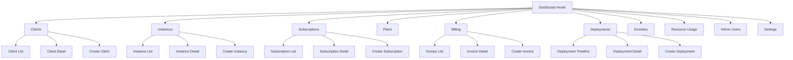

# Propuesta de UI Moderna - Panel de Control Synkro SaaS

## 📊 Diagrama de Navegación



## 🎨 Diseño General

### Estilo Visual
- **Inspiración**: Vercel Dashboard, Stripe Dashboard, Linear
- **Paleta**: Usar colores de Synkro (synkro-green, synkro-black) con acentos sutiles
- **Tipografía**: Geist Sans (ya configurada)
- **Espaciado**: Generoso, respiración visual
- **Sombras**: Sutiles, elevación por capas
- **Bordes**: Redondeados (rounded-lg, rounded-xl)

## 📐 Estructura de Layout

```
┌─────────────────────────────────────────────────────────┐
│  Sidebar (Collapsible)  │  Header  │  User Menu        │
├─────────────────────────┼──────────┼────────────────────┤
│                         │          │                    │
│  Navigation             │  Main Content Area           │
│  - Dashboard            │  - Breadcrumbs               │
│  - Clients              │  - Page Content              │
│  - Instances            │  - Tables/Cards               │
│  - Subscriptions        │  - Forms                      │
│  - Plans                │  - Charts                     │
│  - Billing              │                               │
│  - Deployments          │                               │
│  - Domains              │                               │
│  - Resource Usage       │                               │
│  - Admin Users          │                               │
│                         │                               │
│  Secondary              │                               │
│  - Settings             │                               │
│  - Help                 │                               │
└─────────────────────────┴───────────────────────────────┘
```

## 🏠 Dashboard Principal (`/dashboard`)

### Layout
```
┌─────────────────────────────────────────────────────────┐
│  Welcome Back, [Name]          [Date Picker] [Refresh] │
├─────────────────────────────────────────────────────────┤
│                                                         │
│  ┌──────┐  ┌──────┐  ┌──────┐  ┌──────┐              │
│  │ KPI  │  │ KPI  │  │ KPI  │  │ KPI  │              │
│  │ Card │  │ Card │  │ Card │  │ Card │              │
│  └──────┘  └──────┘  └──────┘  └──────┘              │
│                                                         │
│  ┌────────────────────┐  ┌────────────────────┐       │
│  │  Revenue Chart     │  │  Active Instances  │       │
│  │  (Line/Area)       │  │  Status Overview   │       │
│  └────────────────────┘  └────────────────────┘       │
│                                                         │
│  ┌──────────────────────────────────────────────┐     │
│  │  Recent Activity / Activity Feed              │     │
│  │  - New clients                                │     │
│  │  - Deployments                                │     │
│  │  - Subscription changes                        │     │
│  └──────────────────────────────────────────────┘     │
│                                                         │
│  ┌────────────────────┐  ┌────────────────────┐       │
│  │  Resource Alerts  │  │  Pending Invoices  │       │
│  │  (Critical)       │  │  (Action Items)   │       │
│  └────────────────────┘  └────────────────────┘       │
└─────────────────────────────────────────────────────────┘
```

### KPIs Principales
1. **Total Clients** - Con crecimiento %
2. **Active Instances** - Con estado visual
3. **Monthly Recurring Revenue (MRR)** - Con tendencia
4. **Active Subscriptions** - Con breakdown por plan

## 📋 Páginas Principales

### 1. Clients (`/dashboard/clients`)
```
┌─────────────────────────────────────────────────────────┐
│  Clients                    [Search] [Filter] [+ New]   │
├─────────────────────────────────────────────────────────┤
│                                                         │
│  ┌─────────────────────────────────────────────────┐   │
│  │  Table View (TanStack Table)                   │   │
│  │  ┌─────┬─────────────┬──────────┬──────────┐   │   │
│  │  │ ☐  │ Company     │ Status   │ Actions │   │   │
│  │  ├─────┼─────────────┼──────────┼──────────┤   │   │
│  │  │ ☐  │ Acme Corp   │ Active   │ [•••]    │   │   │
│  │  │ ☐  │ Tech Inc    │ Trial    │ [•••]    │   │   │
│  │  └─────┴─────────────┴──────────┴──────────┘   │   │
│  │                                                 │   │
│  │  [Pagination]                                   │   │
│  └─────────────────────────────────────────────────┘   │
│                                                         │
│  Sidebar: Quick Filters                                │
│  - Status (Active, Trial, Suspended)                   │
│  - Plan Type                                           │
│  - Date Range                                          │
└─────────────────────────────────────────────────────────┘
```

**Características:**
- Tabla con sorting, filtering, pagination
- Vista de cards en mobile
- Bulk actions (selección múltiple)
- Quick actions (ver, editar, eliminar)
- Filtros avanzados en sidebar
- Export a CSV/Excel

### 2. Instances (`/dashboard/instances`)
```
┌─────────────────────────────────────────────────────────┐
│  Instances                 [Search] [Filter] [+ New]     │
├─────────────────────────────────────────────────────────┤
│                                                         │
│  ┌─────────────────────────────────────────────────┐   │
│  │  Card Grid View (Default)                      │   │
│  │  ┌─────────────┐  ┌─────────────┐             │   │
│  │  │ Instance    │  │ Instance    │             │   │
│  │  │ Card        │  │ Card        │             │   │
│  │  │ - Status    │  │ - Status    │             │   │
│  │  │ - URL       │  │ - URL       │             │   │
│  │  │ - Client    │  │ - Client    │             │   │
│  │  │ - Resources │  │ - Resources │             │   │
│  │  └─────────────┘  └─────────────┘             │   │
│  │                                                 │   │
│  │  [Toggle: Grid / Table View]                   │   │
│  └─────────────────────────────────────────────────┘   │
└─────────────────────────────────────────────────────────┘
```

**Características:**
- Vista de cards con status badges coloridos
- Indicadores de salud (CPU, Memory, Storage)
- Quick actions (deploy, restart, view logs)
- Filtros por estado, cliente, región
- Vista de detalles con tabs (Overview, Deployments, Domains, Resources)

### 3. Subscriptions (`/dashboard/subscriptions`)
```
┌─────────────────────────────────────────────────────────┐
│  Subscriptions            [Search] [Filter] [+ New]     │
├─────────────────────────────────────────────────────────┤
│                                                         │
│  Tabs: [All] [Active] [Trial] [Cancelled]              │
│                                                         │
│  ┌─────────────────────────────────────────────────┐   │
│  │  Subscription Cards                              │   │
│  │  ┌─────────────────────────────────────────┐   │   │
│  │  │ Client: Acme Corp                        │   │   │
│  │  │ Plan: Enterprise | Status: Active        │   │   │
│  │  │ Next Payment: $299 | Due: Jan 15, 2025   │   │   │
│  │  │ [View Details] [Manage]                   │   │   │
│  │  └─────────────────────────────────────────┘   │   │
│  └─────────────────────────────────────────────────┘   │
└─────────────────────────────────────────────────────────┘
```

**Características:**
- Vista de cards con información clave
- Timeline visual de cambios de plan
- Quick actions (upgrade, downgrade, cancel)
- Filtros por plan, estado, fecha

### 4. Plans (`/dashboard/plans`)
```
┌─────────────────────────────────────────────────────────┐
│  Plans                      [+ New Plan]                 │
├─────────────────────────────────────────────────────────┤
│                                                         │
│  ┌─────────────────────────────────────────────────┐   │
│  │  Pricing Cards (Similar a landing)              │   │
│  │  ┌──────────┐  ┌──────────┐  ┌──────────┐      │   │
│  │  │ Starter  │  │ Pro      │  │ Enterprise│     │   │
│  │  │ $49/mo   │  │ $149/mo  │  │ $299/mo  │      │   │
│  │  │ [Edit]   │  │ [Edit]   │  │ [Edit]   │      │   │
│  │  └──────────┘  └──────────┘  └──────────┘      │   │
│  └─────────────────────────────────────────────────┘   │
│                                                         │
│  Table View: Detailed breakdown                         │
└─────────────────────────────────────────────────────────┘
```

### 5. Billing (`/dashboard/billing`)
```
┌─────────────────────────────────────────────────────────┐
│  Billing                    [Filter: All/Pending/Paid]   │
├─────────────────────────────────────────────────────────┤
│                                                         │
│  ┌─────────────────────────────────────────────────┐   │
│  │  Invoice List                                    │   │
│  │  ┌─────────────────────────────────────────┐     │   │
│  │  │ Invoice #INV-001                        │     │   │
│  │  │ Client: Acme Corp | $299 | Due: Jan 15  │     │   │
│  │  │ Status: Pending | [View] [Download]     │     │   │
│  │  └─────────────────────────────────────────┘     │   │
│  └─────────────────────────────────────────────────┘   │
│                                                         │
│  Sidebar: Revenue Stats                                 │
│  - This Month: $45,230                                  │
│  - Pending: $12,450                                     │
│  - Overdue: $890                                        │
└─────────────────────────────────────────────────────────┘
```

### 6. Deployments (`/dashboard/deployments`)
```
┌─────────────────────────────────────────────────────────┐
│  Deployments               [Filter by Instance]         │
├─────────────────────────────────────────────────────────┤
│                                                         │
│  ┌─────────────────────────────────────────────────┐   │
│  │  Timeline View                                    │   │
│  │  ┌─────────────────────────────────────────┐     │   │
│  │  │ Instance: acme-corp                      │     │   │
│  │  │ ┌───────────────────────────────────┐ │     │   │
│  │  │ │ v1.2.3 | Completed | 2m ago        │ │     │   │
│  │  │ │ v1.2.2 | Completed | 1d ago        │ │     │   │
│  │  │ │ v1.2.1 | Failed    | 3d ago        │ │     │   │
│  │  │ └───────────────────────────────────┘ │     │   │
│  │  └─────────────────────────────────────────┘     │   │
│  └─────────────────────────────────────────────────┘   │
└─────────────────────────────────────────────────────────┘
```

**Características:**
- Timeline visual de deployments
- Status badges (success, failed, in-progress)
- Logs expandibles
- Filtros por instancia, estado, fecha

### 7. Resource Usage (`/dashboard/resources`)
```
┌─────────────────────────────────────────────────────────┐
│  Resource Usage            [Filter by Instance]         │
├─────────────────────────────────────────────────────────┤
│                                                         │
│  ┌─────────────────────────────────────────────────┐   │
│  │  Resource Cards                                  │   │
│  │  ┌─────────────────────────────────────────┐     │   │
│  │  │ Instance: acme-corp                      │     │   │
│  │  │ Products: 450/500 (90%) [Progress Bar]   │     │   │
│  │  │ Users: 23/50 (46%) [Progress Bar]        │     │   │
│  │  │ Storage: 12.5/20 GB (62%) [Progress Bar]│     │   │
│  │  │ ⚠️ Alert: Products near limit            │     │   │
│  │  └─────────────────────────────────────────┘     │   │
│  └─────────────────────────────────────────────────┘   │
│                                                         │
│  Charts: Usage trends over time                        │
└─────────────────────────────────────────────────────────┘
```

## 🎨 Componentes UI Propuestos

### 1. Status Badge Component
```tsx
<StatusBadge status="active" /> // Verde
<StatusBadge status="trial" />  // Amarillo
<StatusBadge status="suspended" /> // Rojo
<StatusBadge status="cancelled" /> // Gris
```

### 2. Metric Card (Mejorado)
```tsx
<MetricCard
  title="Total Clients"
  value={1250}
  change={+12.5}
  trend="up"
  icon={IconUsers}
/>
```

### 3. Resource Usage Card
```tsx
<ResourceCard
  instance="acme-corp"
  products={{ current: 450, max: 500 }}
  users={{ current: 23, max: 50 }}
  storage={{ current: 12.5, max: 20 }}
  alerts={['products']}
/>
```

### 4. Activity Feed
```tsx
<ActivityFeed>
  <ActivityItem
    type="client_created"
    user="John Doe"
    target="Acme Corp"
    timestamp="2 hours ago"
  />
</ActivityFeed>
```

### 5. Quick Actions Menu
```tsx
<QuickActions>
  <ActionItem icon={IconEdit} label="Edit" />
  <ActionItem icon={IconTrash} label="Delete" />
  <ActionItem icon={IconCopy} label="Duplicate" />
</QuickActions>
```

## 🎯 Características Modernas

### 1. **Búsqueda Global**
- Cmd/Ctrl + K para búsqueda rápida
- Búsqueda en clients, instances, subscriptions
- Navegación rápida

### 2. **Filtros Avanzados**
- Sidebar con filtros persistentes
- Filtros combinables (AND/OR)
- Guardar filtros como vistas

### 3. **Vistas Personalizables**
- Toggle entre Grid/Table/List
- Columnas configurables en tablas
- Ordenamiento personalizado

### 4. **Acciones en Lote**
- Selección múltiple
- Acciones masivas (bulk actions)
- Confirmación antes de acciones destructivas

### 5. **Notificaciones en Tiempo Real**
- Toast notifications para acciones
- Badge de notificaciones en header
- Alertas de recursos críticos

### 6. **Modo Oscuro**
- Ya implementado con next-themes
- Transiciones suaves
- Contraste adecuado

## 📱 Responsive Design

### Mobile (< 768px)
- Sidebar colapsable (drawer)
- Cards en lugar de tablas
- Bottom navigation para acciones principales
- Swipe actions en cards

### Tablet (768px - 1024px)
- Sidebar colapsable
- Tablas con scroll horizontal
- Grid de 2 columnas

### Desktop (> 1024px)
- Sidebar siempre visible
- Tablas completas
- Grid de 3-4 columnas
- Hover states mejorados

## 🚀 Stack Tecnológico

### Ya Implementado ✅
- Next.js 16+ (App Router)
- React Query (TanStack Query)
- shadcn/ui components
- Tailwind CSS
- Framer Motion
- TypeScript

### Componentes a Crear
1. **Dashboard Components**
   - `kpi-card.tsx` (mejorado)
   - `metric-card.tsx`
   - `resource-card.tsx`
   - `activity-feed.tsx`
   - `status-badge.tsx`
   - `quick-actions.tsx`

2. **Layout Components**
   - `dashboard-sidebar.tsx`
   - `dashboard-header.tsx`
   - `breadcrumbs.tsx`
   - `page-header.tsx`

3. **Table Components**
   - `data-table.tsx` (TanStack Table)
   - `table-filters.tsx`
   - `table-pagination.tsx`
   - `bulk-actions.tsx`

4. **Form Components**
   - `client-form.tsx`
   - `instance-form.tsx`
   - `subscription-form.tsx`
   - `plan-form.tsx`

5. **Chart Components**
   - `revenue-chart.tsx` (Recharts o similar)
   - `usage-chart.tsx`
   - `timeline-chart.tsx`

## 🎨 Paleta de Colores para Estados

```css
/* Status Colors */
--status-active: #10b981 (green-500)
--status-trial: #f59e0b (amber-500)
--status-suspended: #ef4444 (red-500)
--status-cancelled: #6b7280 (gray-500)
--status-pending: #3b82f6 (blue-500)

/* Resource Alerts */
--alert-critical: #dc2626 (red-600)
--alert-warning: #f59e0b (amber-500)
--alert-info: #3b82f6 (blue-500)
```

## 📊 Ejemplo de Dashboard Principal

```tsx
// app/(dashboard)/dashboard/page.tsx
'use client'

import { useClients } from '@/hooks/use-clients'
import { useSubscriptions } from '@/hooks/use-subscriptions'
import { useInstances } from '@/hooks/use-instances'
import { KPICard } from '@/components/dashboard/kpi-card'
import { MetricCard } from '@/components/dashboard/metric-card'
import { ActivityFeed } from '@/components/dashboard/activity-feed'

export default function DashboardPage() {
  const { data: clients } = useClients()
  const { data: subscriptions } = useActiveSubscriptions()
  const { data: instances } = useInstances()

  // Calcular métricas
  const totalClients = clients?.length || 0
  const activeInstances = instances?.filter(i => i.estado_instancia === 'activa').length || 0
  const mrr = subscriptions?.reduce((sum, s) => sum + Number(s.precio_actual), 0) || 0

  return (
    <div className="space-y-6">
      <div className="flex items-center justify-between">
        <h1 className="text-3xl font-bold">Dashboard</h1>
        <div className="flex gap-2">
          <DatePicker />
          <RefreshButton />
        </div>
      </div>

      {/* KPI Grid */}
      <div className="grid grid-cols-1 sm:grid-cols-2 lg:grid-cols-4 gap-4">
        <KPICard
          title="Total Clients"
          data={{
            value: totalClients,
            growth: 12.5,
            trend: 'up',
            formatted: totalClients.toLocaleString()
          }}
          icon={IconUsers}
        />
        {/* Más KPIs... */}
      </div>

      {/* Main Content Grid */}
      <div className="grid grid-cols-1 lg:grid-cols-3 gap-6">
        <RevenueChart />
        <ActiveInstancesOverview />
        <ActivityFeed />
      </div>
    </div>
  )
}
```

## 🎯 Principios de Diseño

1. **Clarity First** - Información clara y accesible
2. **Progressive Disclosure** - Mostrar lo esencial, detalles bajo demanda
3. **Consistent Patterns** - Mismos patrones en toda la app
4. **Fast Feedback** - Loading states, optimistic updates
5. **Error Prevention** - Confirmaciones antes de acciones destructivas
6. **Accessibility** - ARIA labels, keyboard navigation

## 📦 Estructura de Carpetas Propuesta

```
app/
├── (dashboard)/
│   ├── dashboard/          # Dashboard principal
│   │   └── page.tsx
│   ├── clients/            # Gestión de clientes
│   │   ├── page.tsx        # Lista
│   │   ├── [id]/           # Detalle
│   │   │   └── page.tsx
│   │   └── new/            # Crear nuevo
│   │       └── page.tsx
│   ├── instances/          # Gestión de instancias
│   ├── subscriptions/      # Gestión de suscripciones
│   ├── plans/              # Gestión de planes
│   ├── billing/            # Facturación
│   ├── deployments/         # Deployments
│   ├── domains/            # Dominios
│   ├── resources/          # Uso de recursos
│   └── settings/           # Configuración
│       ├── layout.tsx      # Layout con sidebar
│       └── ...
│
components/
├── dashboard/
│   ├── kpi-card.tsx
│   ├── metric-card.tsx
│   ├── resource-card.tsx
│   ├── activity-feed.tsx
│   └── ...
├── layout/
│   ├── dashboard-sidebar.tsx
│   ├── dashboard-header.tsx
│   └── breadcrumbs.tsx
└── tables/
    ├── clients-table.tsx
    ├── instances-table.tsx
    └── ...
```

Esta estructura proporciona una base sólida para un panel de control SaaS moderno, profesional y escalable.
