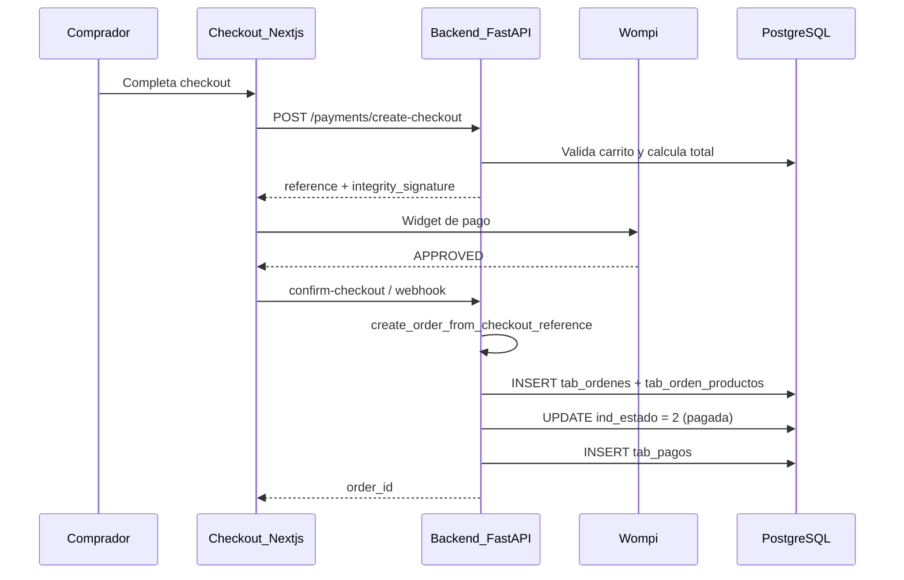
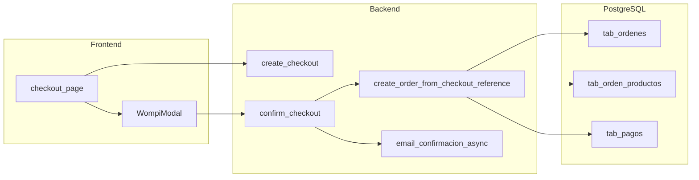

# Estado actual del sistema

Inventario de lo que **existe hoy** en `revital_ecommerce` respecto a pagos, órdenes, datos fiscales y facturación. Base de línea para la integración con Factus en la rama `feat/facturacion-electronica`.

**Última revisión de código:** 2025-06-05

---

## Resumen ejecutivo

| Capacidad | Estado |
|-----------|--------|
| Pagos Wompi (checkout widget) | Implementado |
| Creación de orden tras pago aprobado | Implementado |
| Snapshot de productos en orden | Implementado |
| Datos fiscales del emisor en BD | No implementado |
| Datos fiscales del receptor persistidos | No implementado |
| IVA / tributos en catálogo | No implementado |
| Envío persistido en orden | No implementado (UI simulada) |
| API de facturación electrónica | No implementado |
| Integración Factus | No implementado |

---

## Flujo de pago y orden (lo que sí funciona)

### Secuencia actual



### Archivos clave

| Componente | Ubicación | Rol |
|------------|-----------|-----|
| Crear sesión checkout (sin orden) | `revital_ecommerce/backend/app/routers/payment_widget_router.py` — `POST /payments/create-checkout` | Genera `reference` y firma Wompi; **no crea orden** |
| Confirmar pago y crear orden | `payment_widget_router.py` — `confirm-checkout` | Llama a `create_order_from_checkout_reference` si `APPROVED` |
| Lógica de orden post-pago | `revital_ecommerce/backend/app/services/payment_widget_service.py` — `create_order_from_checkout_reference` | Crea orden, marca pagada, registra pago |
| Email de confirmación | `payment_widget_router.py` líneas 281-284 | `asyncio.create_task(send_order_confirmation_for_order_id)` — patrón async a reutilizar para FE |
| UI checkout | `revital_ecommerce/frontend/app/(shop)/checkout/page.tsx` | Formulario multi-paso; modal Wompi |

### Regla de negocio importante

La orden **solo se crea** cuando Wompi confirma `status === "APPROVED"`. Antes del pago no existe `id_orden` en base de datos.

---

## Base de datos — tablas relevantes

### `tab_ordenes`

Campos actuales (rama `feat/facturacion-electronica`):

- `id_orden`, `fec_pedido`, `id_usuario`
- `val_total_productos`, `val_total_descuentos`, `val_total_pedido`
- `ind_estado` (1=Pendiente, 2=Pagada, 3=Completada)
- `metodo_pago` (`tarjeta`, `efectivo_red_pagos`, `transferencia`)
- `detalle_descuentos_aplicados` (JSON)
- `des_observaciones`

**No tiene:** `val_costo_envio`, `val_descuento_envio`, campos de factura (CUFE, número FE, etc.).

Constraint de totales:

```sql
val_total_pedido = val_total_productos - val_total_descuentos
```

Fuente: `revital_ecommerce/db/db_revital.sql`

### `tab_orden_productos`

Snapshot inmutable de lo comprado:

- `id_combinacion_variante`, `cant_producto`
- `precio_unitario_orden`, `subtotal`
- `opciones_elegidas` (JSONB)

Útil para armar `items[]` del payload Factus.

### `tab_pagos`

Registro de transacciones Wompi:

- `ref_pago`, `id_transaccion_proveedor`, `estado_pago`, `monto`
- `respuesta_cruda`, `ultimo_evento_crudo` (JSONB)

### `tab_usuarios`

- `nom_usuario`, `ape_usuario`, `email_usuario`, `cel_usuario`
- **Sin** tipo de documento, número de identificación ni datos tributarios.

### `tab_direcciones_usuario`

- `calle_direccion`, `ciudad`, `departamento`, `codigo_postal`, `barrio`
- Ciudad y departamento como **texto libre** (sin `municipality_code` DIAN/Factus).

---

## Checkout — datos capturados hoy

### Información del comprador (paso 1)

Nombre, apellidos, dirección de envío, celular, país, departamento, ciudad — se usan para Wompi y visualización, pero **no todos se persisten** en tablas fiscales de orden.

### Dirección de facturación (paso pago)

En `checkout/page.tsx`:

- Checkbox "Utilizar la dirección de envío"
- Si no: `tipoIdentificacion` (CC, CE, NIT, PP) y `numeroIdentificacion`
- Schema: `revital_ecommerce/frontend/schemas/shop/checkout.schema.ts`

**Destino actual de estos datos:** solo el widget Wompi (`legalId`, `legalIdType`). **No se guardan en BD** para facturación.

### Envío

| Aspecto | Estado |
|---------|--------|
| Paso de envío en UI | **Deshabilitado** (`{false && currentStep === 2}`) |
| Métodos de envío | **Hardcodeados** en frontend (Coordinadora, Servientrega, TCC) |
| Comentario en código | "Métodos de envío simulados (luego se conectarán con el backend)" |
| Monto en `create-checkout` | Solo total del **carrito** (sin envío) |
| Persistencia en `tab_ordenes` | No existe columna de costo de envío |

---

## Datos del emisor (tienda)

Hoy el emisor solo tiene datos de marca en variables de entorno:

| Variable | Archivo |
|----------|---------|
| `COMPANY_NAME`, `APP_NAME`, `COMPANY_TAGLINE` | `revital_ecommerce/backend/app/core/config.py` |
| `COMPANY_ADDRESS`, `SUPPORT_EMAIL` | Idem |
| Uso en emails | `revital_ecommerce/backend/app/services/email_templates.py` |

**Faltan para Factus:** NIT, DV, `municipality_code`, `legal_organization_code`, `tribute_code`, rango de numeración, régimen.

El frontend también tiene valores fijos de marca/SEO (p. ej. "Compralo") en `layout.tsx` y `lib/seo.ts` — ver [FEATURE_EMPRESA_Y_FACTURACION_ELECTRONICA.md](../../revital_ecommerce/docs/FEATURE_EMPRESA_Y_FACTURACION_ELECTRONICA.md).

---

## Facturación electrónica — ausencias

Lo siguiente **no existe** en el repositorio:

| Elemento | Estado |
|----------|--------|
| `invoice_router` / rutas `/invoice` | No |
| `electronic_invoice_service.py` | No |
| `factus_client.py` | No |
| `tab_facturas_electronicas` | No |
| `tab_empresa` / perfil fiscal | No |
| `templates/invoices/` | No |
| Variables `FACTUS_*` en config | No |
| UI admin: descargar factura / CUFE | No |
| Email con PDF/XML de FE | No |

La guía de envío Envia (PDF de etiqueta) es **logística**, no factura electrónica DIAN.

---

## Documentación relacionada existente

| Documento | Relación |
|-------------|----------|
| [FEATURE_EMPRESA_Y_FACTURACION_ELECTRONICA.md](../../revital_ecommerce/docs/FEATURE_EMPRESA_Y_FACTURACION_ELECTRONICA.md) | Visión de producto: perfil empresa + Factus |
| [WOMPI_WIDGET_IMPLEMENTATION.md](../../revital_ecommerce/frontend/docs/WOMPI_WIDGET_IMPLEMENTATION.md) | Flujo de pagos actual |
| [ROADMAP / planes en docs/](../../docs/) | Referencias históricas a factura comercial PDF (distinta de FE DIAN) |

---

## Diagrama — estado actual simplificado



**No hay rama hacia Factus ni almacenamiento fiscal.**

---

## Conclusión

El sistema tiene una base sólida de **pagos y órdenes**, pero carece por completo de la capa fiscal necesaria para emitir facturas electrónicas válidas ante la DIAN vía Factus. Las brechas detalladas están en [02-brechas-y-requisitos.md](./02-brechas-y-requisitos.md).
