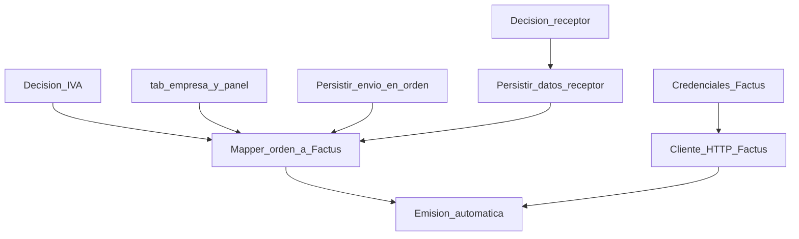

# Brechas y requisitos

Análisis de **lo que falta** para emitir facturas electrónicas vía Factus, organizado por dominio: emisor, receptor, IVA, envío, descuentos, integración técnica y requisitos legales DIAN.

---

## Matriz de brechas

| Área | Estado actual | Brecha | Impacto en Factus |
|------|---------------|--------|-------------------|
| **Emisor** | Variables `.env` con nombre/dirección genérica | Sin perfil fiscal en BD ni panel admin | No hay fuente de verdad para validar coherencia emisor; admin no puede autogestionar |
| **Receptor** | Tipo/número doc solo a Wompi | No persistidos en BD por orden | Payload `customer` incompleto en `POST /v2/bills/validate` |
| **Municipio receptor** | Ciudad/departamento texto libre | Sin `municipality_code` DIAN | Factus rechaza o valida incorrectamente |
| **IVA** | Precios en catálogo sin semántica fiscal | Sin `items.taxes` calculables | Imposible desglosar impuestos correctamente |
| **Envío** | UI simulada, paso deshabilitado | Sin `val_costo_envio` en orden | No se puede emitir línea de envío exenta |
| **Descuento envío** | No modelado | Sin `val_descuento_envio` | Promos de envío gratis no reflejables en FE |
| **Descuentos producto** | Sí en orden (`val_total_descuentos`) | Sin mapeo a Factus | Riesgo de descuadre total factura vs pago |
| **Disparador FE** | Email async post-pago | Sin hook de facturación | Emisión automática imposible |
| **Persistencia FE** | No existe | Sin tabla de documentos | Sin CUFE, reintentos ni auditoría |
| **Cliente HTTP Factus** | No existe | Sin OAuth2 ni llamadas API | Bloqueante técnico |
| **Credenciales Factus** | No disponibles | Sin sandbox configurado | No se puede probar integración |
| **DIAN** | Cliente no habilitado | Sin RUT FE / resolución | Bloqueante para producción |

---

## Requisitos del emisor (vendedor)

Factus configura al emisor en su plataforma; Revital debe mantener datos alineados y permitir al administrador completarlos.

### Campos mínimos propuestos (`tab_empresa`)

| Campo | Obligatorio FE | Fuente Factus / DIAN |
|-------|----------------|----------------------|
| Razón social | Sí | Representación gráfica |
| NIT | Sí | Identificación emisor |
| Dígito de verificación (DV) | Sí (si NIT) | Validación NIT |
| `legal_organization_code` | Sí | Persona jurídica / natural |
| `tribute_code` | Sí | Responsabilidad tributaria (tabla Factus) |
| `municipality_code` | Sí | Tabla municipios Factus |
| Dirección fiscal | Sí | Domicilio fiscal |
| Email de facturación | Sí | Notificaciones |
| Teléfono | Recomendado | Contacto |
| `numbering_range_id` | Condicional | Endpoint rangos de numeración Factus |
| Flag `ind_listo_facturar` | Interno | Checklist de completitud |

### Brecha vs. hoy

- `COMPANY_NAME` y `COMPANY_ADDRESS` en `.env` no sustituyen NIT, municipio ni tributos.
- Decisión del equipo: **BD + panel "Sobre mi negocio"** desde el MVP (ver [06-respuestas-equipo.md](./06-respuestas-equipo.md)).

---

## Requisitos del receptor (comprador)

Factus exige objeto `customer` en cada factura. Campos según [documentación Factus](https://developers.factus.com.co/buenas-practicas/primeros-pasos/):

| Campo Factus | Descripción | Estado en Revital |
|--------------|-------------|-------------------|
| `identification_document_code` | Código tipo doc (13=CC, 31=NIT, etc.) | Parcial en checkout; no persistido |
| `identification` | Número sin DV ni guiones (NIT) | Parcial; solo a Wompi |
| `dv` | Dígito verificación (NIT) | No capturado |
| `legal_organization_code` | Persona natural / jurídica | No capturado |
| `tribute_code` | Responsable IVA o no (ej. ZZ) | No capturado |
| `municipality_code` | Código municipio DIAN | No capturado (solo ciudad texto) |
| Nombre / razón social | Representación gráfica | Parcial (`tab_usuarios`) |
| Email | Contacto | Sí (`email_usuario`) |

### Mapeo checkout actual → Factus

| Checkout (Wompi) | Código Factus sugerido |
|------------------|------------------------|
| CC | 13 |
| CE | 22 |
| NIT | 31 |
| PP (Pasaporte) | 41 |

### Brecha crítica

Los datos de facturación del checkout **no sobreviven** al flujo de pago: no hay tabla ni copia a la orden. La página `profile/orders/[id]` espera `billing_address` pero el backend no lo devuelve.

**Decisión pendiente:** nivel de exigencia en checkout — ver [05-decisiones-pendientes.md](./05-decisiones-pendientes.md).

---

## Requisitos de IVA y tributos en ítems

Factus requiere por cada ítem:

- `price`: precio base **sin impuestos** (según convención elegida)
- `taxes[]`: código de impuesto + porcentaje (tabla referencia Factus)
- `unit_measure_code`: unidad (94 = unidad)
- `standard_code`: identificación producto (999 = código interno contribuyente)
- `discount_rate`: descuento en porcentaje si aplica

### Estado en Revital

| Aspecto | Estado |
|---------|--------|
| Campo IVA en `tab_productos` / variantes | No existe |
| Convención precio con/sin IVA | **No definida** (pendiente) |
| Cálculo en carrito/orden | Solo montos comerciales |
| Desglose en snapshot `tab_orden_productos` | Sin base gravable ni IVA |

### Riesgo

Si el total cobrado en Wompi no coincide con la suma de ítems + impuestos + envío en Factus, la validación DIAN o la reconciliación contable fallan.

**Decisión pendiente:** ver [05-decisiones-pendientes.md](./05-decisiones-pendientes.md).

---

## Requisitos de envío en factura

Decisión del equipo: **el envío sí aparece en la FE, exento de IVA**, incluyendo envío gratis y descuentos sobre envío.

### Brechas técnicas

1. **Checkout:** paso envío deshabilitado; precios simulados en frontend.
2. **`create-checkout`:** monto Wompi = total carrito, sin envío.
3. **`tab_ordenes`:** sin `val_costo_envio` ni `val_descuento_envio`.
4. **Constraint SQL:** `val_total_pedido = val_total_productos - val_total_descuentos` — habrá que extender para incluir envío neto.

### Reglas de negocio a implementar

| Escenario | Comportamiento propuesto |
|-----------|--------------------------|
| Envío con costo | Línea ítem "Servicio de envío", precio neto, `taxes: []` o código exento |
| Envío gratis (`val_costo_envio = 0`) | Omitir línea o línea $0 — validar en sandbox Factus cuál acepta |
| Descuento 100% envío | `val_descuento_envio = val_costo_envio`; línea envío en $0 |
| Descuento parcial envío | Línea con precio = costo − descuento |
| Promoción "envío gratis" global | Misma lógica que descuento total envío |

### Coherencia con Wompi

El monto pagado en Wompi debe reflejar:  
`productos − descuentos_producto + envío − descuento_envío`

Hoy Wompi y la orden pueden no incluir envío — **debe corregirse antes del MVP de FE**.

---

## Requisitos de descuentos (productos)

Existen en el sistema:

- `val_total_descuentos` en `tab_ordenes`
- `detalle_descuentos_aplicados` (JSON)
- Descuentos por código, puntos, automáticos de empresa

### Mapeo a Factus (propuesta)

| Enfoque | Uso |
|---------|-----|
| `discount_rate` por ítem | Descuento proporcional por línea |
| Ajuste en precio unitario del snapshot | Si el descuento ya está embebido en `precio_unitario_orden` |
| Línea de ajuste | Casos especiales (validar con contador) |

**Requisito:** documentar una regla única y testear que `sum(payment_details) == total factura`.

---

## Requisitos técnicos Factus API v2

Referencia: [developers.factus.com.co](https://developers.factus.com.co/)

### Autenticación

| Parámetro | Valor |
|-----------|-------|
| Endpoint sandbox | `POST https://api-sandbox.factus.com.co/oauth/token` |
| Grant type | `password` |
| Credenciales | `client_id`, `client_secret`, `username`, `password` |
| Duración token | ~1 hora (renovar o cachear) |

### Emisión

| Operación | Endpoint |
|-----------|----------|
| Crear y validar factura | `POST /v2/bills/validate` |
| Listar / filtrar | `GET /v2/bills` |
| Descargar PDF | `GET /v2/bills/:number/download-pdf` |
| Descargar XML | `GET /v2/bills/:number/download-xml/` |

### Campos obligatorios clave del body

- `reference_code` — único, idempotente (propuesta: `REVITAL-ORD-{id_orden}`)
- `customer` — objeto completo
- `items[]` — al menos un producto
- `payment_details[]` — suma = total factura (cuando aplica)

### Respuesta a persistir

- `data.cufe`
- `data.number` (número de factura)
- `data.is_validated`, `data.validated_at`
- `data.links.public_url`, `data.links.qr`

### Notas crédito (implementación completa)

- `POST /v2/credit-notes/validate` — decisión del equipo: incluir en etapa completa.

---

## Requisitos legales y operativos (DIAN)

| Requisito | Estado | Responsable |
|-----------|--------|-------------|
| RUT con responsabilidad facturación electrónica | Pendiente | Cliente / contador |
| Resolución DIAN de numeración | Pendiente | Cliente |
| Habilitación ambiente producción DIAN | Pendiente | Cliente |
| Rangos configurados en Factus | Pendiente | Cliente + Factus |
| Cuenta y credenciales API Factus sandbox | Pendiente | Cliente / Revital |

**Nota:** El desarrollo en sandbox puede avanzar sin habilitación DIAN de producción, pero **no se debe prometer FE válida en producción** hasta cerrar requisitos legales.

---

## Requisitos no funcionales

| ID | Requisito |
|----|-----------|
| RNF-FE-01 | Credenciales Factus solo en backend / variables de entorno; nunca en bundle frontend |
| RNF-FE-02 | Fallo en emisión FE no debe revertir pago ni bloquear checkout |
| RNF-FE-03 | Emisión asíncrona post-pago (mismo patrón que email confirmación) |
| RNF-FE-04 | Idempotencia: una orden → máximo una factura (salvo nota crédito) |
| RNF-FE-05 | Registrar payload de error para soporte y reintento manual |
| RNF-FE-06 | Trazabilidad: `reference_code`, `id_orden`, `id_pago` enlazados |

---

## Dependencias entre brechas

---

## Siguiente lectura

- Decisiones del equipo: [06-respuestas-equipo.md](./06-respuestas-equipo.md)
- Decisiones pendientes: [05-decisiones-pendientes.md](./05-decisiones-pendientes.md)
- Propuesta técnica: [03-propuesta-tecnica.md](./03-propuesta-tecnica.md)
- Plan por etapas: [04-plan-por-etapas.md](./04-plan-por-etapas.md)
