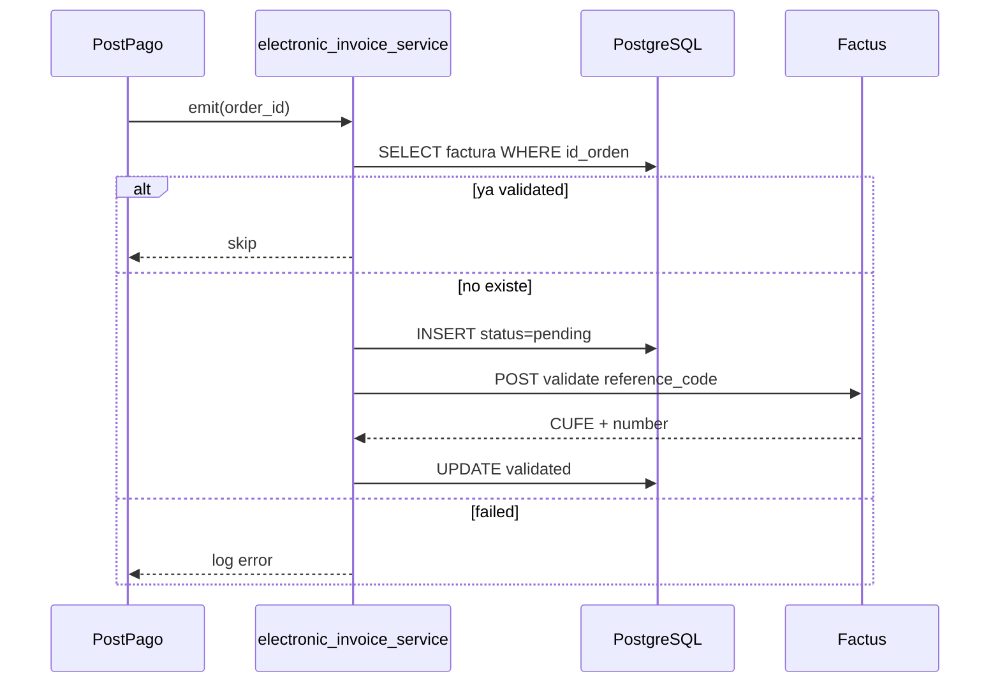

# Propuesta técnica — Integración Factus

Arquitectura, modelo de datos, servicios, endpoints y mapeo Revital → Factus API **v2** para facturación electrónica en `revital_ecommerce`.

**Rama:** `feat/facturacion-electronica`

---

## Principios de diseño

1. **Emisor ≠ receptor** — Perfil de empresa (vendedor) separado de datos fiscales del comprador por orden.
2. **No bloquear el pago** — Emisión FE asíncrona; error Factus no revierte Wompi.
3. **Idempotencia** — `reference_code` único por orden; una factura por `id_orden`.
4. **Secretos en backend** — Credenciales Factus solo en variables de entorno.
5. **Alineación de totales** — Monto Wompi = total factura Factus (productos − descuentos + envío − descuento envío).

---

## Arquitectura objetivo

```mermaid
flowchart TB
  subgraph admin [Panel_Admin]
    EmpresaUI[Sobre_mi_negocio]
    OrdenUI[Detalle_orden_FE]
  end

  subgraph shop [Tienda]
    CheckoutUI[Checkout_fiscal]
  end

  subgraph api [Backend_FastAPI]
    CompanyRouter[company_router]
    InvoiceRouter[invoice_router]
    CompanySvc[company_profile_service]
    InvoiceSvc[electronic_invoice_service]
    Mapper[factus_invoice_mapper]
    Client[factus_client]
  end

  subgraph db [PostgreSQL]
    TabEmpresa[tab_empresa]
    TabBilling[tab_orden_facturacion_cliente]
    TabFE[tab_facturas_electronicas]
    TabOrden[tab_ordenes]
  end

  subgraph factus [Factus_API_v2]
    Token[/oauth/token]
    Validate[POST_bills_validate]
    Pdf[GET_download_pdf]
    Xml[GET_download_xml]
  end

  EmpresaUI --> CompanyRouter --> CompanySvc --> TabEmpresa
  CheckoutUI --> api
  api --> TabBilling
  InvoiceSvc --> Mapper
  Mapper --> TabEmpresa
  Mapper --> TabOrden
  Mapper --> TabBilling
  InvoiceSvc --> Client
  Client --> Token
  Client --> Validate
  InvoiceSvc --> TabFE
  OrdenUI --> InvoiceRouter --> InvoiceSvc
  InvoiceSvc --> Pdf
  InvoiceSvc --> Xml
```

---

## Modelo de datos propuesto

### `tab_empresa` (singleton por instancia)

Una fila por despliegue de cliente.

```sql
-- Esquema conceptual (migración en revital_ecommerce/db/migrations/)
CREATE TABLE tab_empresa (
    id_empresa              DECIMAL(10) PRIMARY KEY DEFAULT 1,
    razon_social            VARCHAR(255) NOT NULL,
    nom_comercial           VARCHAR(255),
    nit                     VARCHAR(20) NOT NULL,
    dv                      VARCHAR(1),
    legal_organization_code VARCHAR(10) NOT NULL,
    tribute_code            VARCHAR(10) NOT NULL DEFAULT 'ZZ',
    municipality_code       VARCHAR(10) NOT NULL,
    direccion_fiscal        VARCHAR(500) NOT NULL,
    email_facturacion       VARCHAR(255) NOT NULL,
    telefono                VARCHAR(30),
    numbering_range_id      INTEGER,          -- Factus; opcional si hay un solo rango
    ind_listo_facturar      BOOLEAN NOT NULL DEFAULT FALSE,
    usr_insert              DECIMAL(10) NOT NULL,
    fec_insert              TIMESTAMP NOT NULL DEFAULT NOW(),
    usr_update              DECIMAL(10),
    fec_update              TIMESTAMP,
    CONSTRAINT chk_singleton CHECK (id_empresa = 1)
);
```

### `tab_orden_facturacion_cliente` (1:1 con orden)

```sql
CREATE TABLE tab_orden_facturacion_cliente (
    id_orden                        DECIMAL(10) PRIMARY KEY REFERENCES tab_ordenes(id_orden),
    identification_document_code    VARCHAR(5) NOT NULL,
    identification                  VARCHAR(30) NOT NULL,
    dv                              VARCHAR(1),
    legal_organization_code         VARCHAR(10) NOT NULL,
    tribute_code                    VARCHAR(10) NOT NULL DEFAULT 'ZZ',
    municipality_code               VARCHAR(10) NOT NULL,
    nombres                         VARCHAR(255) NOT NULL,
    apellidos                       VARCHAR(255),
    email                           VARCHAR(255) NOT NULL,
    telefono                        VARCHAR(30),
    direccion                       VARCHAR(500),
    usr_insert                      DECIMAL(10) NOT NULL,
    fec_insert                      TIMESTAMP NOT NULL DEFAULT NOW()
);
```

### `tab_facturas_electronicas`

```sql
CREATE TABLE tab_facturas_electronicas (
    id_factura          DECIMAL(10) PRIMARY KEY,
    id_orden            DECIMAL(10) NOT NULL UNIQUE REFERENCES tab_ordenes(id_orden),
    reference_code      VARCHAR(64) NOT NULL UNIQUE,
    factus_number       VARCHAR(50),
    prefix              VARCHAR(20),
    cufe                VARCHAR(128),
    status              VARCHAR(20) NOT NULL DEFAULT 'pending',
    -- pending | validated | failed
    is_validated        BOOLEAN NOT NULL DEFAULT FALSE,
    validated_at        TIMESTAMP,
    public_url          VARCHAR(1024),
    qr_url              VARCHAR(1024),
    error_message       TEXT,
    raw_response        JSONB,
    raw_request         JSONB,
    usr_insert          DECIMAL(10) NOT NULL,
    fec_insert          TIMESTAMP NOT NULL DEFAULT NOW(),
    usr_update          DECIMAL(10),
    fec_update          TIMESTAMP
);
CREATE INDEX idx_facturas_status ON tab_facturas_electronicas(status);
```

### Alteraciones a `tab_ordenes`

```sql
ALTER TABLE tab_ordenes
    ADD COLUMN val_costo_envio      DECIMAL(10,0) NOT NULL DEFAULT 0,
    ADD COLUMN val_descuento_envio  DECIMAL(10,0) NOT NULL DEFAULT 0;

-- Actualizar constraint de totales:
-- val_total_pedido = val_total_productos - val_total_descuentos
--                    + val_costo_envio - val_descuento_envio
```

### Metadata de checkout (persistir antes del pago)

Opción A — extender referencia de checkout con tabla dedicada:

```sql
CREATE TABLE tab_checkout_fiscal (
    reference           VARCHAR(255) PRIMARY KEY,
    -- mismos campos fiscales que tab_orden_facturacion_cliente
    val_costo_envio     DECIMAL(10,0) NOT NULL DEFAULT 0,
    val_descuento_envio DECIMAL(10,0) NOT NULL DEFAULT 0,
    shipping_method_id  VARCHAR(80),
    fec_insert          TIMESTAMP NOT NULL DEFAULT NOW()
);
```

Flujo: `create-checkout` guarda fiscal + envío → al crear orden se copia a `tab_orden_facturacion_cliente` y columnas de envío en `tab_ordenes`.

---

## Variables de entorno

```env
# Factus
FACTUS_ENV=sandbox                    # sandbox | production
FACTUS_BASE_URL=https://api-sandbox.factus.com.co
FACTUS_CLIENT_ID=
FACTUS_CLIENT_SECRET=
FACTUS_USERNAME=
FACTUS_PASSWORD=
FACTUS_NUMBERING_RANGE_ID=            # opcional

# Comportamiento
FACTUS_AUTO_EMIT=true                 # emisión automática post-pago
FACTUS_DEFAULT_IVA_RATE=19            # si se adopta Opción A de IVA
```

Documentar en `revital_ecommerce/backend/README.md` sin commitear valores reales.

---

## Servicios backend (nuevos)

| Archivo | Responsabilidad |
|---------|-----------------|
| `services/factus_client.py` | OAuth2, cache token, HTTP a Factus v2, retries |
| `services/factus_invoice_mapper.py` | Orden + empresa + cliente → JSON `bills/validate` |
| `services/electronic_invoice_service.py` | Orquestación, idempotencia, persistencia, reintento |
| `services/company_profile_service.py` | CRUD `tab_empresa`, validación checklist |
| `schemas/factus_schema.py` | Pydantic request/response Factus |
| `schemas/company_schema.py` | Perfil empresa admin/público |
| `routers/company_router.py` | API admin "Sobre mi negocio" |
| `routers/invoice_router.py` | Consulta, reintento, descarga admin |

Registrar routers en `revital_ecommerce/backend/app/main.py`.

---

## Punto de enganche — emisión automática

Tras marcar orden pagada en `create_order_from_checkout_reference`:

**Archivo:** `revital_ecommerce/backend/app/services/payment_widget_service.py`  
**Momento:** Después de `update_order_payment_info(..., ind_estado=2)` exitoso.

**También en:** `confirm-checkout` (`payment_widget_router.py`) — patrón paralelo al email:

```python
asyncio.create_task(emit_electronic_invoice_if_ready(order_id))
```

Condiciones previas en `emit_electronic_invoice_if_ready`:

1. `FACTUS_AUTO_EMIT=true`
2. `tab_empresa.ind_listo_facturar = true`
3. No existe fila `tab_facturas_electronicas` con `status IN ('validated', 'pending')` para esa orden
4. Datos en `tab_orden_facturacion_cliente` completos

---

## Endpoints API propuestos

### Perfil empresa (admin)

| Método | Ruta | Descripción |
|--------|------|-------------|
| `GET` | `/admin/company` | Obtener perfil emisor |
| `PUT` | `/admin/company` | Actualizar perfil |
| `GET` | `/admin/company/readiness` | Checklist campos faltantes para FE |

### Facturas (admin)

| Método | Ruta | Descripción |
|--------|------|-------------|
| `GET` | `/admin/orders/{id_orden}/invoice` | Estado FE (CUFE, número, URLs, error) |
| `POST` | `/admin/orders/{id_orden}/invoice/retry` | Reintento manual |
| `GET` | `/admin/orders/{id_orden}/invoice/pdf` | Proxy descarga PDF Factus |
| `GET` | `/admin/orders/{id_orden}/invoice/xml` | Proxy descarga XML |
| `GET` | `/admin/invoices` | Listado paginado con filtros |

### Checkout (extensión)

| Método | Ruta | Descripción |
|--------|------|-------------|
| `POST` | `/payments/create-checkout` | **Extender** body con datos fiscales + envío |

### Tienda (post-MVP)

| Método | Ruta | Descripción |
|--------|------|-------------|
| `GET` | `/orders/{id_orden}/invoice` | Estado FE del comprador (solo su orden) |

---

## Mapeo Revital → Factus `POST /v2/bills/validate`

### Cabecera factura

| Campo Factus | Valor Revital |
|--------------|---------------|
| `reference_code` | `REVITAL-ORD-{id_orden}` |
| `document` | `01` (factura venta) |
| `operation_type` | `10` (estándar) |
| `numbering_range_id` | `tab_empresa.numbering_range_id` o default Factus |
| `observation` | `Orden {id_orden} | Ref Wompi {ref_pago}` |

### `customer`

Desde `tab_orden_facturacion_cliente` + validaciones de formato (NIT sin guión en `identification`, DV aparte).

### `items[]` — productos

Por cada fila en `tab_orden_productos` (join nombre producto):

| Campo Factus | Fuente |
|--------------|--------|
| `code_reference` | `id_producto` o SKU |
| `name` | Nombre snapshot / catálogo |
| `quantity` | `cant_producto` |
| `price` | Base sin IVA (según decisión IVA) |
| `unit_measure_code` | `94` (unidad) |
| `standard_code` | `999` (código interno) |
| `discount_rate` | % derivado de descuentos orden |
| `taxes` | `[{ code: IVA, percentage: 19 }]` si aplica |

### `items[]` — envío (exento IVA)

Si `val_costo_envio - val_descuento_envio > 0` (o según prueba sandbox con $0):

| Campo | Valor |
|-------|-------|
| `code_reference` | `SHIPPING` |
| `name` | `Servicio de envío` |
| `quantity` | `1` |
| `price` | `val_costo_envio - val_descuento_envio` |
| `taxes` | `[]` o código exento según tabla Factus |

### `payment_details[]`

Mapeo desde `tab_pagos` / `metodo_pago`:

| Revital | Código Factus (validar en tabla medios de pago) |
|---------|--------------------------------------------------|
| `tarjeta` | Tarjeta débito/crédito |
| `transferencia` | Transferencia / PSE |
| `efectivo_red_pagos` | Efectivo / corresponsal |

**Regla:** `sum(payment_details[].value) == total factura`.

---

## Cliente HTTP Factus (`factus_client.py`)

### Autenticación

```
POST {FACTUS_BASE_URL}/oauth/token
Content-Type: application/x-www-form-urlencoded

grant_type=password
client_id=...
client_secret=...
username=...
password=...
```

Respuesta: `access_token`, `refresh_token`, `expires_in`.

Cache en memoria con margen de 5 min antes de expiración. En despliegues multi-worker, considerar Redis (mejora futura).

### Operaciones

| Método | Función Python |
|--------|----------------|
| `validate_bill(payload)` | `POST /v2/bills/validate` |
| `download_pdf(number)` | `GET /v2/bills/{number}/download-pdf` |
| `download_xml(number)` | `GET /v2/bills/{number}/download-xml/` |
| `list_bills(filters)` | `GET /v2/bills?filter[reference_code]=...` |

### Manejo de errores

| Código / caso | Acción |
|---------------|--------|
| 401 | Renovar token y reintentar una vez |
| 422 validación | `status=failed`, guardar `error_message` y body |
| 5xx / timeout | `status=pending` o `failed` según política; reintento manual |
| Duplicado `reference_code` | Consultar factura existente por filtro; no recrear |

---

## Frontend — cambios propuestos

### Admin

| Ruta | Componente |
|------|------------|
| `/admin/company` o `/admin/settings/business` | Formulario "Sobre mi negocio" |
| `/admin/orders/[id]` | Sección factura: estado, CUFE, descargar, reintentar |

Patrón de datos: similar a `use-top-info-bar.ts` + servicio en `services/`.

### Checkout

1. Hacer obligatorios campos fiscales (según decisión receptor).
2. Select de municipio (código Factus).
3. Re-habilitar o integrar paso envío con costo real enviado a `create-checkout`.
4. Si `useShippingAddress`: copiar datos de dirección envío + doc si aplica.

---

## Idempotencia y concurrencia



- `reference_code` estable por `id_orden`.
- Lock transaccional o unique constraint evita duplicados.
- Reintento manual resetea `failed` → nuevo intento con mismo `reference_code` (Factus debe ser idempotente por referencia).

---

## Mejoras incorporadas en la propuesta

| Mejora | Beneficio |
|--------|-----------|
| Tabla checkout fiscal | No perder datos entre create-checkout y confirm |
| `raw_request` / `raw_response` JSONB | Soporte y auditoría |
| Checklist `readiness` | Admin sabe qué falta antes de producción |
| Proxy PDF/XML admin | No exponer token Factus al frontend |
| Mapper aislado | Tests unitarios sin llamar API real |

---

## Referencias

- [Factus — Introducción](https://developers.factus.com.co/)
- [Factus — Autenticación](https://developers.factus.com.co/autenticacion/auth/)
- [Factus — Crear y validar](https://developers.factus.com.co/facturas/crear-y-validar/)
- [Factus — Campos de factura](https://developers.factus.com.co/facturas/descripcion-de-campos/)
- [FEATURE_EMPRESA_Y_FACTURACION_ELECTRONICA.md](../../revital_ecommerce/docs/FEATURE_EMPRESA_Y_FACTURACION_ELECTRONICA.md)

---

## Historial

| Fecha | Cambio |
|-------|--------|
| 2025-06-05 | Propuesta técnica inicial |
