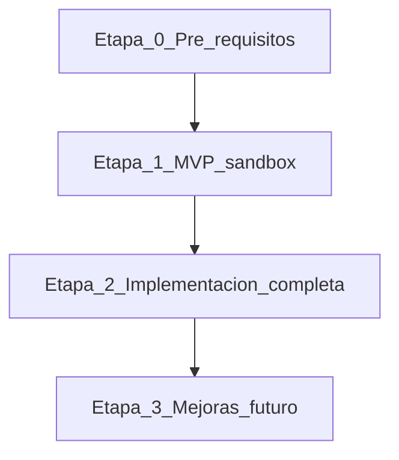

# Plan por etapas

Hoja de ruta para implementar facturación electrónica con Factus en `revital_ecommerce`, dividida en cuatro etapas: pre-requisitos, MVP funcional, implementación completa y mejoras a futuro.

**Rama:** `feat/facturacion-electronica`

---

## Vista general



| Etapa | Objetivo | Entregable principal |
|-------|----------|----------------------|
| 0 | Desbloquear dependencias externas y decisiones | Checklist pre-requisitos cerrado |
| 1 | Primera factura válida en sandbox | Emisión auto + CUFE en BD |
| 2 | Producto listo para operación real | PDF/XML, notas crédito, producción |
| 3 | Escala y optimización | Colas, RADIAN, dashboard |

---

## Etapa 0 — Pre-requisitos

**Objetivo:** Tener todo lo necesario **antes** de escribir integración productiva con Factus.

### 0.1 Legal y DIAN (cliente piloto)

| Tarea | Responsable | Estado |
|-------|-------------|--------|
| Confirmar RUT con responsabilidad FE | Cliente / contador | Pendiente |
| Obtener resolución de numeración DIAN | Cliente | Pendiente |
| Habilitación en ambiente producción DIAN | Cliente | Pendiente |
| Configurar rangos en panel Factus | Cliente + Factus | Pendiente |

**Nota:** Sandbox puede usarse sin producción DIAN, pero **no prometer FE legal en producción** hasta cerrar esta tabla.

### 0.2 Cuenta y credenciales Factus

| Tarea | Responsable | Estado |
|-------|-------------|--------|
| Crear cuenta Factus | Cliente / Revital | Pendiente |
| Solicitar credenciales sandbox (`client_id`, `client_secret`, `username`, `password`) | Factus | Pendiente |
| Documentar variables en `.env.example` (sin valores) | Desarrollo | Pendiente |
| Verificar suscripción / cuota API (`GET /v1/subscriptions`) | Desarrollo | Pendiente |

### 0.3 Decisiones de producto y fiscalidad

| Tarea | Documento | Bloquea MVP |
|-------|-----------|-------------|
| Cerrar política IVA | [05-decisiones-pendientes.md](./05-decisiones-pendientes.md) §1 | Sí |
| Cerrar campos receptor en checkout | [05-decisiones-pendientes.md](./05-decisiones-pendientes.md) §2 | Sí |
| Obtener tabla municipios Factus | [05-decisiones-pendientes.md](./05-decisiones-pendientes.md) §3 | Sí |
| Validar representación envío $0 en sandbox | [05-decisiones-pendientes.md](./05-decisiones-pendientes.md) §4 | Parcial |

### 0.4 Criterio de salida Etapa 0

- [ ] Credenciales Factus sandbox en mano (almacenadas de forma segura, no en git)
- [ ] Decisión IVA documentada en [06-respuestas-equipo.md](./06-respuestas-equipo.md)
- [ ] Decisión datos receptor documentada
- [ ] Catálogo municipios disponible para desarrollo
- [ ] Plan de habilitación DIAN acordado con cliente (fechas)

---

## Etapa 1 — Mínimo funcional (MVP sandbox)

**Objetivo:** Una orden pagada en sandbox genera factura electrónica, persiste CUFE y permite reintento manual.

### 1.1 Base de datos

| # | Tarea | Archivo / ubicación |
|---|-------|---------------------|
| 1 | Migración `tab_empresa` | `revital_ecommerce/db/migrations/` |
| 2 | Migración `tab_orden_facturacion_cliente` | Idem |
| 3 | Migración `tab_facturas_electronicas` | Idem |
| 4 | Migración `tab_checkout_fiscal` (o equivalente) | Idem |
| 5 | `ALTER tab_ordenes` — envío y constraint totales | Idem |
| 6 | Actualizar `db_revital.sql` base | `revital_ecommerce/db/db_revital.sql` |

### 1.2 Perfil emisor — backend + admin

| # | Tarea |
|---|-------|
| 7 | `company_profile_service.py` + schemas Pydantic |
| 8 | `company_router.py` — GET/PUT admin + readiness |
| 9 | Página admin "Sobre mi negocio" |
| 10 | Checklist visual: campos faltantes para `ind_listo_facturar` |

### 1.3 Checkout y persistencia receptor + envío

| # | Tarea |
|---|-------|
| 11 | Extender formulario checkout (tipo doc, NIT+DV, municipio, persona natural/jurídica) |
| 12 | Enviar datos fiscales + costo envío en `create-checkout` |
| 13 | Persistir en `tab_checkout_fiscal` |
| 14 | Al crear orden: copiar a `tab_orden_facturacion_cliente` y columnas envío |
| 15 | Alinear monto Wompi con total incluyendo envío neto |
| 16 | Reconectar o habilitar selección de método/costo de envío |

### 1.4 Integración Factus

| # | Tarea |
|---|-------|
| 17 | Variables `FACTUS_*` en `config.py` |
| 18 | `factus_client.py` — OAuth2 + validate + cache token |
| 19 | `factus_invoice_mapper.py` — según decisión IVA |
| 20 | `electronic_invoice_service.py` — idempotencia + persistencia |
| 21 | Hook async post-pago en `payment_widget_service.py` |
| 22 | `invoice_router.py` — GET estado + POST retry |

### 1.5 Pruebas MVP

| # | Tarea |
|---|-------|
| 23 | Script o guía Postman: primera factura sandbox |
| 24 | Caso: orden con descuento producto |
| 25 | Caso: envío con costo |
| 26 | Caso: envío gratis / descuento envío 100% |
| 27 | Caso: reintento tras fallo simulado |
| 28 | Verificar idempotencia (doble confirm-checkout / webhook) |

### Criterio de done — Etapa 1

- [ ] Admin completa perfil empresa y `ind_listo_facturar = true`
- [ ] Checkout persiste datos fiscales del comprador
- [ ] Orden pagada dispara emisión automática (async)
- [ ] `tab_facturas_electronicas` contiene CUFE y número en sandbox
- [ ] Admin puede ver estado y reintentar emisión fallida
- [ ] Guía de prueba E2E documentada en esta carpeta o en `revital_ecommerce/docs/`

**Estimación orientativa:** 2–3 semanas de desarrollo (según cierre de decisiones Etapa 0).

---

## Etapa 2 — Implementación completa

**Objetivo:** Operación lista para piloto en producción (con DIAN habilitado) y experiencia completa admin + comprador.

### 2.1 Descargas y comunicación

| # | Tarea |
|---|-------|
| 1 | Endpoints descarga PDF/XML (proxy admin) |
| 2 | UI admin en detalle orden: badge, CUFE, botones descargar/reintentar |
| 3 | Email al comprador con enlace o adjunto PDF FE |
| 4 | Endpoint comprador `GET /orders/{id}/invoice` (solo propia orden) |

### 2.2 Notas crédito

| # | Tarea |
|---|-------|
| 5 | Tabla `tab_notas_credito_electronicas` (opcional) o extensión de documentos |
| 6 | Servicio `POST /v2/credit-notes/validate` |
| 7 | Disparador desde flujo devoluciones / cancelación orden |
| 8 | UI admin: emitir y consultar NC |

### 2.3 Fiscalidad avanzada

| # | Tarea |
|---|-------|
| 9 | IVA por producto si se adoptó modelo mixto (Opción C) |
| 10 | Catálogo municipios mantenible (sync periódico) |
| 11 | Validaciones NIT/DV en backend |

### 2.4 Producción

| # | Tarea |
|---|-------|
| 12 | Variables `FACTUS_*` producción |
| 13 | Checklist paso sandbox → producción |
| 14 | Prueba factura real con DIAN habilitado |
| 15 | Runbook incidentes (fallo Factus, token, numeración agotada) |

### 2.5 Calidad

| # | Tarea |
|---|-------|
| 16 | Tests pytest: mapper (IVA, envío, descuentos) |
| 17 | Tests pytest: idempotencia servicio |
| 18 | Tests pytest: cliente Factus mockeado (httpx) |
| 19 | Logs estructurados con `id_orden`, `reference_code`, `trace_id` |

### Criterio de done — Etapa 2

- [ ] Cliente recibe PDF o enlace FE tras compra
- [ ] Admin descarga XML y PDF
- [ ] Nota crédito emitible en sandbox para devolución
- [ ] Factura producción validada ante DIAN (cliente habilitado)
- [ ] Tests automatizados en CI para mapper y servicio

**Estimación orientativa:** 2–4 semanas adicionales.

---

## Etapa 3 — Mejoras a futuro

**Objetivo:** Robustez operativa, visibilidad y extensiones. No bloquean el piloto.

### 3.1 Resiliencia

| Mejora | Descripción |
|--------|-------------|
| Cola de reintentos | Worker/cron para `status=failed` transitorios |
| Circuit breaker | Pausar emisiones si Factus devuelve 5xx sostenido |
| Redis token cache | Tokens compartidos entre workers |

### 3.2 RADIAN y cumplimiento

| Mejora | Descripción |
|--------|-------------|
| Eventos RADIAN | `GET /v1/bills/:number/radian/events` |
| Sincronización estados | Actualizar UI según eventos DIAN |

### 3.3 Producto y negocio

| Mejora | Descripción |
|--------|-------------|
| Dashboard facturación | KPIs: emitidas, fallidas, pendientes |
| Consumidor final automático | Por umbral de monto (si legal lo permite) |
| Multi-rango numeración | Varias sedes o tipos de documento |
| Factura comercial PDF interna | Distinta de FE DIAN (si se requiere comercial) |
| Sync contable | Alegra u otro ERP |

### 3.4 White-label

| Mejora | Descripción |
|--------|-------------|
| Integrar perfil empresa con SEO/contacto | Fases B–C de [FEATURE_EMPRESA](../../revital_ecommerce/docs/FEATURE_EMPRESA_Y_FACTURACION_ELECTRONICA.md) |
| Sustituir hardcodes "Compralo" | Layout, contacto, emails |

---

## Riesgos y mitigaciones

| Riesgo | Probabilidad | Mitigación |
|--------|--------------|------------|
| DIAN no habilitado a tiempo | Alta | Desarrollar en sandbox; comunicar dependencia legal |
| Descuadre total Wompi vs Factus | Media | Tests de mapper; regla única de redondeo COP |
| Municipio incorrecto | Media | Select con código; no texto libre |
| Token Factus expirado mid-batch | Baja | Refresh automático en cliente |
| Numeración agotada | Baja | Alerta admin + mensaje claro en retry |

---

## Orden de ejecución recomendado

```
Etapa 0 (paralelo con diseño)
    ↓
Etapa 1.1 BD → 1.2 Empresa → 1.3 Checkout → 1.4 Factus → 1.5 Pruebas
    ↓
Etapa 2 (por prioridad: descargas/UI → NC → producción → tests)
    ↓
Etapa 3 (backlog priorizado con cliente)
```

---

## Trazabilidad con documentos

| Documento | Uso en plan |
|-----------|-------------|
| [01-estado-actual.md](./01-estado-actual.md) | Línea base |
| [02-brechas-y-requisitos.md](./02-brechas-y-requisitos.md) | Qué cerrar en cada etapa |
| [03-propuesta-tecnica.md](./03-propuesta-tecnica.md) | Cómo implementar |
| [05-decisiones-pendientes.md](./05-decisiones-pendientes.md) | Gate Etapa 0 |
| [06-respuestas-equipo.md](./06-respuestas-equipo.md) | Decisiones fijas |

---

## Historial

| Fecha | Cambio |
|-------|--------|
| 2025-06-05 | Plan por etapas inicial |
