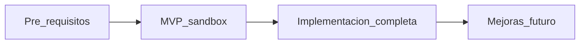

# Facturación electrónica — Factus (Colombia / DIAN)

Documentación de análisis, planeación e implementación de **facturación electrónica** en `revital_ecommerce`, integrando la [API de Factus](https://developers.factus.com.co/) (v2).

**Rama de trabajo:** `feat/facturacion-electronica`  
**Última actualización:** 2025-06-05

---

## Resumen ejecutivo

Revital es un e-commerce desplegado por instancia (un cliente = una BD + dominio). Hoy el sistema tiene **pagos Wompi y órdenes funcionales**, pero **no existe API de facturas** ni integración con proveedor tecnológico DIAN.

Este directorio es la **fuente de verdad** para:

- Entender qué hay y qué falta (IVA, emisor, receptor, envío).
- Decisiones del equipo y preguntas abiertas.
- Propuesta técnica (tablas, servicios, endpoints, mapeo Factus).
- Plan por etapas hasta producción y mejoras futuras.

### Decisiones clave ya tomadas

| Tema | Decisión |
|------|----------|
| Proveedor | Factus API v2 |
| Emisor | Tabla en BD + panel admin "Sobre mi negocio" |
| Envío en FE | Sí, línea exenta de IVA; contemplar gratis y descuentos |
| Disparador | Automático al pagar + reintento manual en admin |
| Notas crédito | Incluidas en implementación completa |
| Credenciales Factus | Pre-requisito (pendiente) |
| DIAN cliente piloto | No habilitado aún (bloqueante producción) |

Detalle: [06-respuestas-equipo.md](./06-respuestas-equipo.md)

### Pendiente de cerrar

- Política de **IVA** en precios del catálogo.
- Campos **receptor** obligatorios en checkout.

Opciones y recomendaciones: [05-decisiones-pendientes.md](./05-decisiones-pendientes.md)

---

## Índice de documentos

| # | Documento | Contenido |
|---|-----------|-----------|
| 1 | [01-estado-actual.md](./01-estado-actual.md) | Inventario del código y BD: pagos, órdenes, checkout, ausencias |
| 2 | [02-brechas-y-requisitos.md](./02-brechas-y-requisitos.md) | Gaps (emisor, receptor, IVA, envío, Factus, DIAN) y requisitos |
| 3 | [03-propuesta-tecnica.md](./03-propuesta-tecnica.md) | Arquitectura, tablas, servicios, endpoints, mapeo Factus |
| 4 | [04-plan-por-etapas.md](./04-plan-por-etapas.md) | Pre-requisitos → MVP → completo → mejoras futuras |
| 5 | [05-decisiones-pendientes.md](./05-decisiones-pendientes.md) | IVA, receptor, municipios — opciones y recomendación |
| 6 | [06-respuestas-equipo.md](./06-respuestas-equipo.md) | Decisiones de la sesión de planeación |

---

## Plan por etapas (vista rápida)

| Etapa | Meta |
|-------|------|
| **0 — Pre-requisitos** | Credenciales Factus, decisiones IVA/receptor, plan DIAN |
| **1 — MVP** | Primera FE en sandbox, CUFE en BD, reintento admin |
| **2 — Completo** | PDF/XML, email cliente, notas crédito, producción |
| **3 — Futuro** | Colas, RADIAN, dashboard, sync contable |

Detalle de tareas y criterios de done: [04-plan-por-etapas.md](./04-plan-por-etapas.md)

---

## Documentación relacionada

| Recurso | Ubicación |
|---------|-----------|
| Visión producto perfil empresa + FE | [revital_ecommerce/docs/FEATURE_EMPRESA_Y_FACTURACION_ELECTRONICA.md](../../revital_ecommerce/docs/FEATURE_EMPRESA_Y_FACTURACION_ELECTRONICA.md) |
| Pagos Wompi (backend) | [revital_ecommerce/backend/app/Docs/WOMPI_WIDGET_INTEGRATION.md](../../revital_ecommerce/backend/app/Docs/WOMPI_WIDGET_INTEGRATION.md) |
| Pagos Wompi (frontend) | [revital_ecommerce/frontend/docs/WOMPI_WIDGET_IMPLEMENTATION.md](../../revital_ecommerce/frontend/docs/WOMPI_WIDGET_IMPLEMENTATION.md) |
| Factus API oficial | [developers.factus.com.co](https://developers.factus.com.co/) |

---

## Convenciones

- API Factus: usar **v2** (`/v2/bills/validate`), no v1.
- `reference_code` propuesto: `REVITAL-ORD-{id_orden}`.
- Emisor (tienda) y receptor (comprador) son dominios separados.
- Fallo en emisión FE **no** debe revertir un pago Wompi aprobado.

---

## Mantenimiento

Al cerrar decisiones o completar etapas:

1. Actualizar [06-respuestas-equipo.md](./06-respuestas-equipo.md).
2. Marcar criterios de done en [04-plan-por-etapas.md](./04-plan-por-etapas.md).
3. Añadir guías de prueba (p. ej. `07-guia-pruebas-sandbox.md`) cuando existan credenciales.
