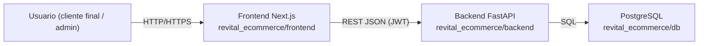
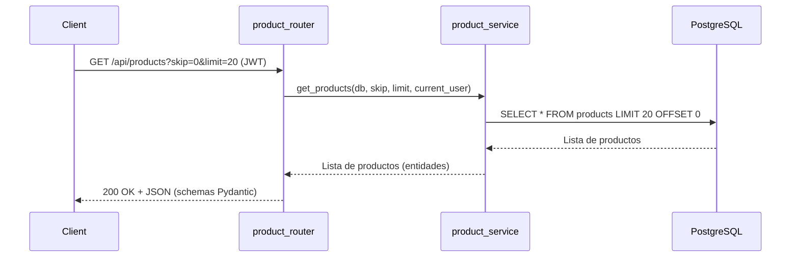
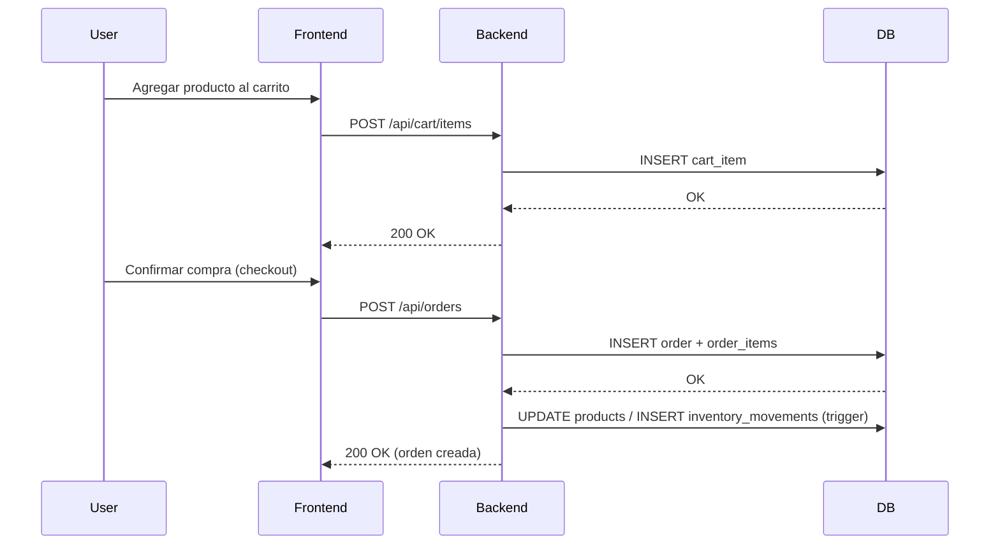
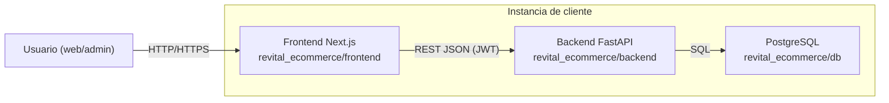
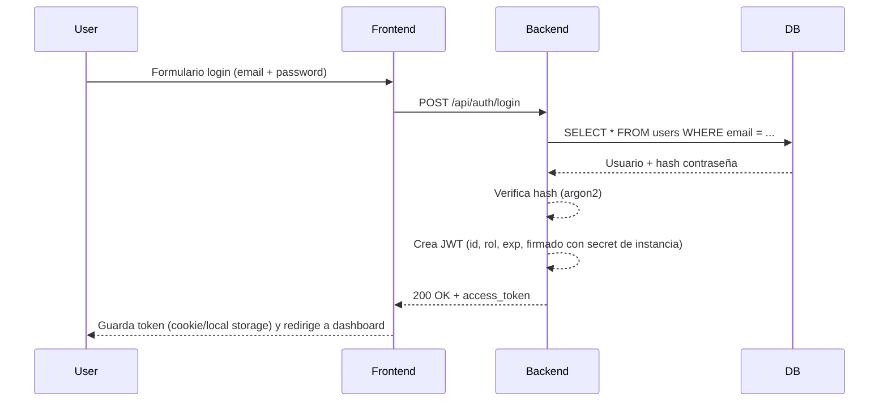

# Explicación completa de `revital_ecommerce` (para exposición técnica)

## 0. Contexto general y modelo SaaS

**revital_ecommerce** es la aplicación de e‑commerce que se despliega **una vez por cada cliente**. No es multi‑tenant dentro del código, sino **multi‑instancia** a nivel de infraestructura:

- Cada empresa que contrata Revital obtiene:
  - Su propio **backend** (FastAPI)
  - Su propio **frontend** (Next.js)
  - Su propia **base de datos PostgreSQL**
  - Sus propios **secretos y configuración** en `.env`
- No existe `tenant_id` en todas las tablas; el aislamiento se hace por:
  - **Instancia de la app**
  - **Base de datos dedicada**
  - **JWT secret** específico por cliente

Arquitectura a alto nivel de una sola instancia:



---

## 1. Visión general de `revital_ecommerce`

- **Contexto SaaS**:
  - `revital_ecommerce` es la **tienda online por instancia de cliente**.
  - Existe otra app llamada `revital_panel` que gestiona la parte SaaS (planes, instancias, etc.), pero tu exposición se centra en la instancia de tienda (`revital_ecommerce`).

- **Deployment aislado**:
  - Cada cliente tiene:
    - Un contenedor / servidor para el backend FastAPI.
    - Un contenedor / servidor para el frontend Next.js.
    - Una base de datos PostgreSQL dedicada (`db_revital.sql`).
    - Un `.env` con:
      - `DATABASE_URL`
      - `JWT_SECRET_KEY`
      - Claves de Wompi, Resend, etc.
  - Esto simplifica el código: no hay que filtrar por tenant en cada consulta.

- **Capas principales**:
  - **Backend**: `revital_ecommerce/backend`
  - **Frontend**: `revital_ecommerce/frontend`
  - **Base de datos**: `revital_ecommerce/db`

---

## 2. Arquitectura del backend (FastAPI)

**Stack**: FastAPI, Python 3.13+, PostgreSQL, SQLAlchemy, Pydantic, JWT, argon2.

### 2.1 Estructura de carpetas clave

Ruta base: `revital_ecommerce/backend/app`

- `core/`
  - `config.py`: carga todas las variables de entorno (DB, JWT, plan, límites, Wompi, Resend, etc.).
  - `database.py`: crea el engine de PostgreSQL y la sesión (`SessionLocal`).
  - `dependencies.py`: dependencias comunes de FastAPI (por ejemplo `get_db`).
  - `jwt_utils.py`: funciones para crear y verificar tokens JWT.

- `middlewares/`
  - `auth_middleware.py`: extrae el JWT del header, lo valida y adjunta el usuario a la request.
  - `role_middleware.py`: verifica que el usuario tenga el rol necesario (ADMIN, EMPLOYEE, CUSTOMER).

- `routers/` (capa de entrada HTTP)
  - `auth_router.py`: login, registro, refresh de tokens.
  - `user_router.py`: gestión de usuarios.
  - `product_router.py`: CRUD de productos + filtros + búsqueda.
  - `category_router.py`, `lines_router.py`, `subline_router.py`.
  - `brand_router.py`, `provider_router.py`.
  - `cart_product_router.py`: carrito.
  - `order_router.py`: órdenes de compra.
  - `payment_router.py`: integración con Wompi.
  - `address_router.py`, `favorites_router.py`, `discount_router.py`, `points_router.py`.
  - `movements_inventory_router.py`: movimientos de inventario.
  - `order_buy_provider_router.py`: órdenes a proveedores.
  - Y otros routers especializados (comentarios, CMS, emails, etc.).

- `schemas/` (Pydantic – contratos de la API)
  - `auth_schema.py`: login, registro, token, payload.
  - `user_schema.py`, `product_schema.py`, `order_schema.py`, `cart_schema.py`, etc.
  - Se usan tanto para **validar requests** como para **documentar responses** en OpenAPI.

- `services/` (lógica de negocio)
  - `auth_service.py`: autenticar users, hashear/verificar contraseña, emitir tokens.
  - `product_service.py`: reglas para CRUD de productos (límite de productos según plan, etc.).
  - `cart_service.py`: manejo del carrito, totales, migración anónimo→usuario registrado.
  - `order_service.py`: crear órdenes, validar stock, actualizar inventario.
  - `payment_service.py`: orquestación con Wompi.
  - `email_service.py`: envío de emails con Resend.
  - Otros servicios para cada dominio (descuentos, puntos, CMS, etc.).

- `templates/emails/`
  - Plantillas HTML para emails transaccionales (confirmación de compra, recuperación de password, etc.).

- `Docs/`
  - Documentación técnica: configuración JWT, integración Resend, etc.

- `main.py`
  - Crea la instancia `FastAPI()`.
  - Conecta los routers: `app.include_router(product_router, prefix="/api/products", ...)`.
  - Configura CORS.
  - Registra middlewares globales.
  - Expone endpoints como `/docs`, `/redoc`, `/health`.

### 2.2 Patrón de capas (Clean Architecture simplificada)

La lógica sigue un flujo **Router → Service → Base de datos**, con `schemas` alrededor para validación.

- **Router**:
  - Define la ruta, el método HTTP y los parámetros.
  - Usa `Depends` para:
    - Obtener `db: Session`.
    - Obtener `current_user` y validar roles.
  - No contiene lógica de negocio compleja, sólo orquestación básica.

- **Service**:
  - Contiene la lógica de negocio:
    - Validaciones de dominio.
    - Reglas según plan de suscripción (por ejemplo `MAX_PRODUCTS`).
    - Coordinación entre modelos y operaciones.

- **DB/Modelos**:
  - SQLAlchemy mapea tablas de PostgreSQL a clases Python.
  - Ejemplo: `Product`, `User`, `Order`, etc.

- **Schemas**:
  - Entradas: DTOs para requests (`ProductCreate`, `UserLogin`, etc.).
  - Salidas: DTOs para responses (`ProductResponse`, `OrderDetail`, etc.).

Ejemplo conceptual de flujo de un endpoint de productos:



### 2.3 Conexión a la base de datos

En `app/core/database.py` (a nivel conceptual):

- Se lee `DATABASE_URL` desde `.env`.
- Se crea un `engine` de SQLAlchemy apuntando a la base dedicada de esa instancia.
- Se define `SessionLocal` (session factory).
- Se expone `get_db()`:

```python
def get_db():
    db = SessionLocal()
    try:
        yield db
    finally:
        db.close()
```

Los routers usan:

```python
@router.get("/products")
async def get_products(
    skip: int = 0,
    limit: int = 100,
    db: Session = Depends(get_db),
    current_user: UserInToken = Depends(get_current_user),
):
    return await product_service.get_products(db, skip=skip, limit=limit)
```

---

## 3. Sistema de autenticación y seguridad (JWT)

### 3.1 Roles y modelo de usuario

Se utiliza un enum simple para roles dentro de una instancia:

```python
class UserRole(IntEnum):
    ADMIN = 1      # Admin de la empresa (dueño de la tienda)
    EMPLOYEE = 2   # Empleados de la empresa
    CUSTOMER = 3   # Cliente final que compra
```

- El usuario autenticado se representa como un objeto tipo `UserInToken` o similar.
- El rol se incluye en el payload del JWT.

### 3.2 Generación de tokens JWT

En `jwt_utils.py` (conceptual):

- Se recibe un diccionario `data` (id de usuario, rol, etc.).
- Se agrega la expiración (`exp`) usando `ACCESS_TOKEN_EXPIRE_MINUTES`.
- Se firma con el `JWT_SECRET_KEY` **específico de esa instancia**.

```python
def create_access_token(data: dict):
    to_encode = data.copy()
    expire = datetime.utcnow() + timedelta(minutes=ACCESS_TOKEN_EXPIRE_MINUTES)
    to_encode.update({"exp": expire})
    encoded_jwt = jwt.encode(to_encode, JWT_SECRET_KEY, algorithm=JWT_ALGORITHM)
    return encoded_jwt
```

Cada cliente tiene su propio `JWT_SECRET_KEY` en `.env`, por lo que los tokens **no son válidos entre instancias**.

### 3.3 Flujo de login

1. El usuario llama a `POST /api/auth/login` enviando email y password.
2. `auth_router`:
   - Valida el body con `LoginSchema`.
   - Llama a `auth_service.authenticate_user(...)`.
3. `auth_service`:
   - Busca al usuario en DB.
   - Verifica el hash de la contraseña con `argon2`.
   - Si es correcto, construye el payload (`sub`, `role`, etc.) y llama a `create_access_token`.
4. El endpoint devuelve:
   - `access_token`
   - `token_type`
   - Información básica del usuario (opcional).

### 3.4 Protección de rutas

- Para obtener el usuario actual:
  - Se usa una dependencia tipo `get_current_user` que:
    - Lee `Authorization: Bearer <token>`.
    - Decodifica JWT con `JWT_SECRET_KEY`.
    - Carga el usuario desde DB.
- Para restringir por rol:
  - Se usa una dependencia `require_admin()` o `require_role(UserRole.ADMIN)`.

Ejemplo conceptual:

```python
@router.post("/products")
async def create_product(
    product_data: ProductCreate,
    current_user: UserInToken = Depends(require_admin()),
    db: Session = Depends(get_db),
):
    return await product_service.create_product(db, product_data)
```

### 3.5 Otras medidas de seguridad

- **Hash de contraseñas**: `argon2-cffi` (resistente a ataques de fuerza bruta).
- **CORS**: configuración en `main.py` para permitir sólo orígenes válidos (dominio del frontend).
- **Variables de entorno**:
  - `.env`, `.env.development`, `.env.production`.
  - Separan secretos entre desarrollo y producción.
- **Health checks**:
  - Endpoint `/health` que verifica:
    - Conectividad a la DB (`SELECT 1`).
    - Que la configuración del cliente (plan, features, Wompi, etc.) esté correcta.

---

## 4. Arquitectura de la base de datos (PostgreSQL)

**Ubicación**: `revital_ecommerce/db`

- `db_revital.sql`: script con el esquema completo.
- `Functions/`: funciones SQL por tabla o módulo (filtros, cálculos, analytics).
- `triggers/`: triggers que se disparan en inserciones/actualizaciones.
- `views/`: vistas (y vistas materializadas) para analytics.

### 4.1 Tablas principales

A alto nivel (sin entrar en todos los nombres de columnas):

- `users`: usuarios de la instancia (admin, employee, customer).
- `products`: productos.
- `categories`, `lines`, `sublines`: jerarquía de categorías.
- `brands`: marcas.
- `providers`: proveedores.
- `cart` + `cart_items`: carrito de compra.
- `orders` + `order_items`: órdenes y detalle.
- `addresses`: direcciones de envío.
- `discounts`, `coupons`: descuentos.
- `points`, `points_movements`: sistema de puntos.
- `inventory_movements`: entradas y salidas de stock.
- Tablas adicionales para comentarios, CMS, etc.

Relaciones típicas:

- Un `product` pertenece a una `category` y opcionalmente a una `brand`.
- Una `order` pertenece a un `user` (cliente).
- Una `order` tiene muchas filas en `order_items`.
- `inventory_movements` referencia productos y órdenes/proveedores.

### 4.2 Funciones, triggers y vistas

- **Funciones**:
  - Filtros avanzados de productos (búsqueda, paginado, múltiples filtros en la DB).
  - Cálculos de métricas (ventas totales, productos más vendidos, etc.).
- **Triggers**:
  - Al crear una orden:
    - Disminuye stock del producto.
    - Registra un `inventory_movement`.
  - Al registrar una compra:
    - Aumenta los puntos del usuario.
- **Vistas / vistas materializadas**:
  - Para analytics:
    - Ventas por categoría.
    - Ventas por rango de fechas.
    - Clientes top.
    - Productos top.

---

## 5. Arquitectura del frontend (Next.js)

**Stack**: Next.js 16 (App Router), React 19, TypeScript, Tailwind, shadcn/ui, React Query, Zustand.

### 5.1 Estructura principal

Ruta base: `revital_ecommerce/frontend`

- `app/`
  - `(shop)/`: tienda pública:
    - `page.tsx`: home de la tienda.
    - `products/`: listado con filtros.
    - `product/[id]/`: detalle de producto.
    - `cart/`: carrito.
    - `checkout/`: pasos de compra (dependiendo de implementación actual).
  - `(auth)/`:
    - `login/`, `register/`, recuperación de contraseña.
  - `(dashboard)/`:
    - `admin/`: dashboard administrativo.
      - `products/`, `categories/`, `lines/`, `sublines/`.
      - `brands/`, `providers/`.
      - `orders/`, `users/`, `analytics/`.
  - `layout.tsx`, `globals.css`, `not-found.tsx`, etc.

- `components/`
  - `ui/`: componentes base (inputs, buttons, cards, tablas, banners de cookies, etc.).
  - `admin/`: formularios y componentes para panel admin.
  - `products-page/`: header de productos, filtros, grid, paginación.
  - `product/`: card de producto, detalles, galería de imágenes.
  - `cart/`: item de carrito, resumen de totales.
  - `layout/`: header, footer, navegación, componentes de dashboard.
  - `auth/`: route-guards, formularios de login/registro.
  - `providers/`: providers de contexto (auth, theme, React Query).

- `hooks/`
  - `use-auth`: manejar sesión (login, logout, usuario actual).
  - `use-cart`: carrito (añadir, quitar, leer estado, sincronizar con backend).
  - `use-products`, `use-categories`, `use-brands`, etc.
  - `use-filter-products`: lógica de filtros.
  - `use-cookies`, `use-theme`: cookies y modo oscuro.

- `services/`
  - `auth.service.ts`, `product.service.ts`, `cart.service.ts`, `user.service.ts`, etc.
  - Cada service encapsula las llamadas HTTP a la API backend.

- `stores/`
  - `cart-store.ts`: store Zustand para tener carrito persistente en el cliente.

- `types/`
  - Definiciones TypeScript para productos, usuarios, órdenes, etc.

- `utils/`
  - `apiWrapper.ts`: wrapper del cliente HTTP.
  - `format-price.ts`, `cart-helpers.ts`, `product-helpers.ts`, etc.

- `lib/`
  - `config.ts`: configuración general.
  - `theme-config.ts`: tema, colores, etc.

### 5.2 Conexión con el backend

- Variable de entorno principal: `NEXT_PUBLIC_API_URL`, por ejemplo:
  - `http://localhost:8000/api` en desarrollo.
- `apiWrapper.ts` configura:
  - Base URL (`NEXT_PUBLIC_API_URL`).
  - Interceptores (por ejemplo, adjuntar JWT al header `Authorization`).

Los hooks usan React Query para consumir estas APIs:

```ts
const { data: products } = useQuery({
  queryKey: ['products', filters],
  queryFn: () => api.get('/products', { params: filters }),
});
```

### 5.3 Ejemplo de flujo: `ProductCard` y carrito

- Componente `ProductCard`:
  - Recibe un objeto `product`.
  - Muestra imagen, nombre, precio, atributos específicos (ej. talla, color).
  - Al hacer clic en “Agregar”:
    - Llama a `addToCart(product)` del hook `useCart`.
- `useCart`:
  - Actualiza el estado global en `cart-store` (Zustand).
  - Opcionalmente sincroniza con el backend (carrito persistente).
- El backend:
  - Recibe las operaciones de agregar/quitar producto.
  - Calcula totales, valida stock, etc.

---

## 6. Conexiones end‑to‑end (flujo completo)

### 6.1 Flujo: usuario compra un producto

1. **Frontend**:
   - Usuario entra a `/products`.
   - Cambia filtros → el frontend llama a `/api/products` con query params.
   - Selecciona un producto → va a `/product/[id]`.
   - Hace clic en “Agregar al carrito” → `useCart` + `cart.service.ts`.
   - Va a `/cart` y luego a `/checkout`.

2. **Backend**:
   - Endpoints de carrito (`/api/cart`) guardan los items y calculan totales.
   - En checkout, se crea una orden (`/api/orders`):
     - Valida stock.
     - Calcula totales definitivos.
     - Inserta en tablas `orders` y `order_items`.
     - Dispara integración con Wompi (`/api/payments`).

3. **Base de datos**:
   - Inserta orden y detalle.
   - Triggers actualizan inventario (`inventory_movements`).
   - Se registran puntos del cliente, si aplica.

Diagrama de secuencia simplificado:



### 6.2 Flujo de administración

1. Admin hace login → recibe JWT.
2. Entra al dashboard admin (`/admin`).
3. Desde el dashboard:
   - Crea/edita productos → `POST/PUT /api/products` con header `Authorization: Bearer <token>`.
   - Gestiona categorías, marcas, proveedores, etc.
4. Backend:
   - Verifica rol ADMIN.
   - Ejecuta lógica en `product_service`, `category_service`, etc.
   - Actualiza tablas correspondientes en PostgreSQL.

---

## 7. Seguridad, buenas prácticas y ventajas del modelo aislado

### 7.1 Seguridad por diseño

- **Sin multi‑tenancy en DB**:
  - Cada cliente tiene su propia base de datos → imposible hacer un `SELECT` cruzado entre clientes por error.
- **JWT por instancia**:
  - Cada instancia define su `JWT_SECRET_KEY` distinto.
  - Un token emitido para la instancia del Cliente A no funciona en la instancia del Cliente B.
- **Hash de contraseñas**:
  - Se usa `argon2`, que es robusto frente a ataques de fuerza bruta.
- **CORS**:
  - El backend sólo acepta peticiones desde los orígenes permitidos (dominio del frontend del cliente).
- **Rate limiting / middlewares**:
  - Se pueden añadir límites a nivel de instancia para proteger la API.
- **Health checks**:
  - Endpoint `/health` que comprueba conectividad a DB, configuración de plan, integración con Wompi, etc.

### 7.2 Ventajas del modelo de instancias aisladas

- **Aislamiento de datos**:
  - Cada cliente tiene sus datos en su propia base.
- **Backups y restore por cliente**:
  - Se puede restaurar sólo la DB de un cliente sin afectar a otros.
- **Escalado horizontal**:
  - Se escala “por cliente”: más recursos (CPU, RAM) a la instancia que los necesita.
- **Cumplimiento normativo**:
  - Cumple con regulaciones tipo GDPR al ofrecer aislamiento fuerte de datos.
- **Simplicidad en el código**:
  - No se maneja `tenant_id` en todas las queries.
  - El desarrollador piensa en una tienda “normal” de e‑commerce, pero por fuera se despliega n veces.

---

## 8. Microservicios vs arquitectura actual

### 8.1 ¿Es microservicios?

- **No** en el sentido clásico.
- El backend es **una API monolítica modular**:
  - Un proceso FastAPI.
  - Múltiples routers y servicios bien separados por dominio.
  - Una sola base de datos por instancia.

### 8.2 Modularidad interna

- Cada dominio está aislado a nivel de código:
  - `product_router` + `product_service` + `product_schema` + tablas de productos.
  - `order_router` + `order_service` + sus schemas + tablas de órdenes.
- Esto permite:
  - Mantener el código organizado.
  - Facilitar un posible futuro desglose a microservicios si fuera necesario.

Frase que puedes usar en la exposición:

> “No usamos microservicios clásicos, sino un **monolito modular** por instancia: una sola API FastAPI, pero organizada por dominios (productos, usuarios, pedidos, pagos) en routers y servicios independientes. Esto simplifica la operación y al mismo tiempo mantiene una buena separación de responsabilidades.”

---

## 9. Guion sugerido para tu exposición (10–20 minutos)

### 0–2 min: Contexto SaaS e instancias aisladas

- Explicar qué es Revital y qué es `revital_ecommerce`.
- Diferencia entre:
  - Multi‑tenant clásico (una app + un DB con many tenants).
  - Multi‑instancia (una app y un DB por cliente).
- Ventaja de tener una instancia aislada por cliente.

### 2–6 min: Backend (FastAPI, capas, JWT, DB)

- Enseñar la estructura de `revital_ecommerce/backend/app`.
- Explicar el patrón Router → Service → DB.
- Explicar cómo se conecta a PostgreSQL (`database.py` + `get_db`).
- Contar el flujo básico de un endpoint (por ejemplo `/api/products`).
- Entrar al detalle de JWT:
  - Roles (ADMIN, EMPLOYEE, CUSTOMER).
  - `create_access_token`.
  - Protección de rutas y middlewares.

### 6–10 min: Frontend (Next.js, flujo de compra, conexión API)

- Enseñar la estructura de `revital_ecommerce/frontend` (app router, components, hooks, services).
- Explicar `NEXT_PUBLIC_API_URL` y `apiWrapper`.
- Contar el flujo:
  - Catálogo → detalle de producto → carrito → checkout.
- Cómo el frontend usa React Query y Zustand para consumir la API y manejar estado.

### 10–14 min: Base de datos y lógica en funciones/triggers

- Explicar a alto nivel `revital_ecommerce/db`:
  - `db_revital.sql`, `Functions/`, `triggers/`, `views/`.
- Mencionar:
  - Tablas principales (users, products, orders, cart, etc.).
  - Triggers que actualizan inventario y puntos.
  - Vistas para analytics.

### 14–18 min: Seguridad, ventajas y cierre

- Reforzar:
  - Hash de contraseñas con argon2.
  - JWT por instancia.
  - CORS, health checks, aislamiento de datos.
- Ventajas de la arquitectura:
  - Simplicidad de desarrollo (sin `tenant_id`).
  - Escalado y backups por cliente.
  - Cumplimiento normativo.
- Cierre: cómo todo esto convierte a `revital_ecommerce` en una solución SaaS robusta y extensible.

---

## 10. Diagramas Mermaid para tus diapositivas

### 10.1 Arquitectura general de una instancia



### 10.2 Flujo de login con JWT (simplificado)



Con este `.md` tienes:

- Visión general
- Arquitectura de backend, frontend y DB
- Explicación de JWT y seguridad
- Conexiones end‑to‑end
- Diferencia con microservicios
- Guion sugerido + diagramas para tus slides

