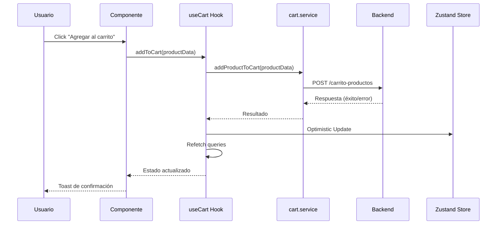
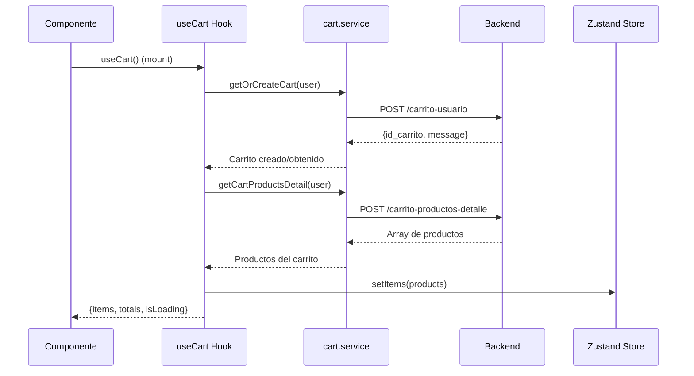

# 🛒 Guía de Integración del Carrito

## 📋 Resumen

Esta guía documenta la implementación completa del sistema de carrito de compras en Synkro, desde el frontend hasta el backend.

## 🏗️ Arquitectura del Sistema

```
┌─────────────────┐    ┌─────────────────┐    ┌─────────────────┐
│   Components    │    │     Hooks       │    │    Services     │
│                 │    │                 │    │                 │
│ • ProductInfo   │───▶│ • useCart()     │───▶│ • cart.service  │
│ • ProductGrid   │    │ • useCartInfo() │    │ • apiWrapper    │
│ • ProductList   │    │                 │    │                 │
│ • CartPage      │    │                 │    │                 │
└─────────────────┘    └─────────────────┘    └─────────────────┘
         │                       │                       │
         ▼                       ▼                       ▼
┌─────────────────┐    ┌─────────────────┐    ┌─────────────────┐
│   Zustand       │    │  React Query    │    │    Backend      │
│   Store         │    │    Cache        │    │     API         │
│                 │    │                 │    │                 │
│ • cart-store.ts │    │ • Queries       │    │ • FastAPI       │
│ • Persistencia  │    │ • Mutations     │    │ • PostgreSQL    │
│ • Estado local  │    │ • Invalidation  │    │ • Endpoints     │
└─────────────────┘    └─────────────────┘    └─────────────────┘
```

## 🔧 Componentes Implementados

### 1. **Página Individual de Producto** ✅
**Archivo:** `frontend/app/(shop)/products/[id]/page.tsx`

**Funcionalidad:**
- Botón "AGREGAR AL CARRITO" completamente funcional
- Conexión con `useCart()` hook
- Manejo de colores y tallas seleccionadas
- Toast de confirmación
- Navegación al carrito

**Código clave:**
```typescript
const { addToCart, isAddingToCart, error: cartError } = useCart()

const handleAddToCart = async (selectedColor?: string, selectedSize?: string) => {
  const cartProductData = {
    id_categoria_producto: product.id_categoria_producto || 1,
    id_linea_producto: product.id_linea_producto || 1, 
    id_sublinea_producto: product.id_sublinea_producto || 1,
    id_producto: product.id_producto,
    cantidad: 1,
    precio_unitario_carrito: parseFloat(product.val_precio.toString())
  }
  
  addToCart(cartProductData)
}
```

### 2. **Vista de Grilla de Productos** ✅
**Archivo:** `frontend/components/products-page/products-display.tsx`

**Funcionalidad:**
- Botón "Agregar al carrito" en cada producto
- Verificación de stock antes de agregar
- Toast de feedback (éxito/error)
- Búsqueda de producto en la lista

**Código clave:**
```typescript
const handleAddToCart = async (productId: string) => {
  // Buscar el producto en la lista
  const product = productsData?.data?.find((p: any) => p.id_producto.toString() === productId)
  
  // Verificar stock
  if (product.num_stock <= 0) {
    toast.error('Producto agotado')
    return
  }
  
  // Agregar al carrito
  addToCart(cartProductData)
  toast.success(`${product.nom_producto} agregado al carrito`)
}
```

### 3. **Vista de Lista de Productos** ⏳
**Estado:** Pendiente de implementación
**Archivo:** `frontend/components/product/product-list.tsx`

### 4. **Tarjetas de Productos** ⏳
**Estado:** Pendiente de implementación  
**Archivo:** `frontend/components/product/product-card.tsx`

## 🔄 Flujo de Datos

### Agregar Producto al Carrito



### Cargar Carrito



## 📊 Estados del Sistema

### Estados del Hook useCart()

```typescript
interface CartState {
  // Datos
  items: CartProductDetail[]
  totals: CartTotalResponse | null
  itemCount: number
  total: number
  
  // Estados UI
  isLoading: boolean
  error: string | null
  hasItems: boolean
  
  // Estados de operaciones
  isAddingToCart: boolean
  isUpdatingQuantity: boolean
  isRemoving: boolean
}
```

### Estados del Zustand Store

```typescript
interface CartState {
  // Estado del carrito
  id_carrito?: number
  items: CartItem[]
  totals: CartTotalResponse | null
  
  // Estado de la UI
  isLoading: boolean
  error: string | null
  isOpen: boolean
  
  // Usuario
  cartUser: CartUser
}
```

## 🎯 Casos de Uso Implementados

### ✅ Casos de Uso Funcionando

1. **Agregar producto individual** - Página de producto
2. **Agregar desde grilla** - Lista de productos
3. **Ver carrito** - Navegación desde header
4. **Mostrar count** - Ícono del carrito en header
5. **Persistencia** - Carrito guardado entre sesiones
6. **Usuarios anónimos** - Session ID automático
7. **Usuarios registrados** - ID de usuario
8. **Cálculos del backend** - Totales, descuentos, puntos

### ⏳ Casos de Uso Pendientes

1. **Agregar desde lista** - Vista de lista de productos
2. **Agregar desde cards** - Tarjetas de productos
3. **Códigos promocionales** - Input y aplicación
4. **Favoritos** - Toggle de productos favoritos
5. **Checkout** - Proceso de compra

## 🔧 Configuración y Uso

### Para Desarrolladores

**1. Usar el hook en un componente:**
```typescript
import { useCart } from '@/hooks/use-cart'

const MyComponent = () => {
  const { 
    addToCart, 
    items, 
    itemCount, 
    isAddingToCart 
  } = useCart()
  
  const handleAdd = () => {
    addToCart({
      id_producto: 123,
      cantidad: 1,
      precio_unitario_carrito: 29.99,
      // ... otros campos requeridos
    })
  }
}
```

**2. Solo obtener información básica:**
```typescript
import { useCartInfo } from '@/hooks/use-cart'

const Header = () => {
  const { itemCount, total, isLoading } = useCartInfo()
  
  return (
    <div>
      Carrito ({itemCount}) - ${total}
    </div>
  )
}
```

**3. Verificar si un producto está en el carrito:**
```typescript
import { useIsInCart } from '@/hooks/use-cart'

const ProductComponent = ({ productId }) => {
  const isInCart = useIsInCart(productId)
  
  return (
    <div>
      {isInCart ? 'En el carrito' : 'Agregar al carrito'}
    </div>
  )
}
```

## 🚨 Manejo de Errores

### Errores Comunes

1. **Producto no encontrado**
   - Toast: "Producto no encontrado"
   - No se agrega al carrito

2. **Producto sin stock**
   - Toast: "Producto agotado"
   - No se agrega al carrito

3. **Error de conexión**
   - Toast: "Error al agregar producto al carrito"
   - Rollback del optimistic update

4. **Token expirado**
   - Refresh automático del token
   - Reintentar operación

## 🔄 Próximos Pasos

### Fase 2 Restante

1. **Conectar ProductList** - Vista de lista
2. **Conectar ProductCard** - Tarjetas de productos
3. **Mejorar botones del carrito** - Cantidad y eliminar
4. **Implementar códigos promocionales**

### Fase 3 - Avanzado

1. **Estados de carga mejorados** - Skeletons
2. **Sincronización entre pestañas** - Broadcast Channel
3. **Carrito offline** - Service Worker
4. **Notificaciones push** - Carrito abandonado

## 📈 Métricas y Monitoreo

### Eventos Importantes

- `cart.product.added` - Producto agregado
- `cart.product.removed` - Producto eliminado
- `cart.quantity.updated` - Cantidad actualizada
- `cart.checkout.started` - Inicio de checkout
- `cart.error.occurred` - Error en operación

### Logs de Debug

```typescript
// Activar logs detallados
localStorage.setItem('debug', 'cart:*')

// Ver en consola:
// 🛒 Obteniendo carrito para usuario: {id_usuario: 123}
// ✅ Carrito obtenido: {id_carrito: 456}
// 🛒 Agregando producto al carrito: {id_producto: 789}
```

---

**Fecha de creación:** $(date)
**Última actualización:** $(date)
**Versión:** 1.0.0
**Autor:** Synkro Development Team
