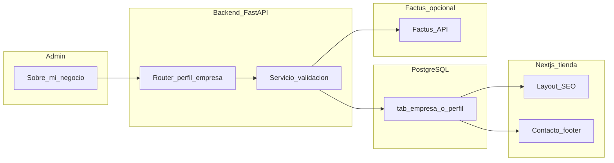

# Feature: Información de empresa y facturación electrónica (Colombia)

Este documento describe la **meta**, el **alcance**, las **mini metas**, un **plan por fases** y los **riesgos** asociados a centralizar la información del negocio en cada instancia de `revital_ecommerce` y preparar la integración con **Factus** para facturación electrónica acorde a la DIAN.

---

## 1. Resumen ejecutivo

`revital_ecommerce` se despliega **una vez por cliente** (instancia aislada: base de datos, dominio y configuración propios). Para vender el producto como e-commerce **white-label** y altamente personalizable, hace falta que el administrador pueda definir de forma centralizada:

- Identidad y datos legales de la empresa (razón social, NIT, dirección fiscal, etc.).
- Datos de contacto y presencia pública (email, teléfono, redes, horarios).
- Metadatos de marca y **SEO** (título del sitio, descripción, imagen Open Graph, etc.).
- En el futuro cercano, los datos del **emisor** necesarios para emitir factura electrónica mediante un proveedor tecnológico (p. ej. **Factus API**).

Hoy parte de esa información está **hardcodeada** en el frontend (nombre “Compralo”, descripciones SEO, página de contacto mock) o repartida en configuración estática. Eso impide personalizar por cliente sin tocar código y dificulta enlazar de forma consistente la futura emisión de documentos electrónicos.

---

## 2. Meta principal

**Una sola fuente de verdad** (“perfil de empresa” / “sobre mi negocio”) almacenada en la base de datos de la instancia, editable desde el panel de administración, que permita:

| Consumidor | Uso |
|------------|-----|
| Tienda pública (Next.js) | Título del sitio, meta description, JSON-LD Organization, contacto, footer, favicon/logo si aplica. |
| Emails transaccionales (backend) | Nombre de empresa, datos legales mínimos en pie de correo (según plantillas). |
| Integración Factus (backend) | Datos del emisor alineados con el payload de creación/validación de factura (NIT, DV, municipio, tributos según tablas Factus, etc.). |

El diseño del panel debe ser **coherente** con patrones ya existentes en el proyecto, por ejemplo la **barra informativa** que persiste configuración en `tab_cms_content` con un `nom_cms_content` fijo y payload JSONB (`top_info_bar`), servicio dedicado y router FastAPI.

---

## 3. Estado actual en el código (referencias)

Estos puntos sirven como línea base; conviene revisarlos al implementar la feature.

| Área | Ubicación | Nota |
|------|-----------|------|
| SEO global y nombre de sitio | `revital_ecommerce/frontend/app/layout.tsx`, `revital_ecommerce/frontend/lib/seo.ts` | Valores fijos (p. ej. nombre “Compralo”); `buildBaseMetadata` / `siteName` deberían alimentarse del perfil o de API pública. |
| Contacto | `revital_ecommerce/frontend/app/(shop)/contacto/page.tsx` | Datos mock (`MOCK`); deben sustituirse por datos del perfil. |
| Config CMS reutilizable | `revital_ecommerce/backend/app/services/top_info_bar_service.py` | Patrón: fila en `tab_cms_content` con nombre lógico + JSONB; endpoints admin + público según necesidad. |
| Multi-tenant pagos | `revital_ecommerce/backend/app/core/tenant.py` | Wompi preparado para `x-store-id`/subdominio con fallback a settings globales; el perfil de empresa debe convivir con la estrategia futura de tenant. |
| Checkout | `revital_ecommerce/frontend/app/(shop)/checkout/page.tsx` | Captura datos del **comprador** (incl. tipo doc. CC/NIT); no sustituye al perfil del **emisor**. |
| Admin: enlaces “Configuración” / SEO | `revital_ecommerce/frontend/components/layout/dashboard/sidebar.tsx` | Algunos ítems secundarios pueden estar comentados; la nueva ruta debe quedar integrada en navegación. |

---

## 4. Mini metas

Cada mini meta incluye **criterios de “hecho”** orientativos.

### 4.1 Panel “Sobre mi negocio” (admin)

- **Objetivo**: Pantalla en el dashboard donde un administrador complete y actualice el perfil de la empresa.
- **Contenido sugerido (pestañas o secciones)**:
  - **Empresa y legal**: razón social, NIT, dígito de verificación (si aplica), tipo de persona/organización, dirección fiscal, ciudad/municipio (IDs alineados con Factus cuando exista integración), régimen o notas legales breves, enlaces a términos/privacidad si se gestionan como URLs.
  - **Contacto público**: email, teléfono, dirección de atención, horario, redes sociales.
  - **Marca y SEO**: nombre comercial, descripción corta para `<meta name="description">`, título por defecto, imagen OG (URL o referencia a asset), opcional `robots` / Twitter cards.
- **Criterios de hecho**:
  - Solo usuarios con rol administrador pueden guardar cambios.
  - Validación en cliente y en servidor (Pydantic).
  - Mensajes de error claros; indicador de “perfil incompleto” para FE si faltan campos obligatorios para Factus.

### 4.2 Tabla (o esquema) para almacenar la información de la empresa

- **Objetivo**: Persistencia robusta y consultable por el backend y, donde aplique, exposición controlada al frontend.
- **Enfoque recomendado (híbrido)**:
  - **Tabla tipada** (p. ej. `tab_empresa` o `tab_company_profile`) para campos fiscales, identificación, DV, municipio_id, email legal, razón social — facilita validaciones, índices y reportes.
  - **Opcional**: seguir usando `tab_cms_content` para bloques de texto largos o secciones editoriales si no deben ser campos estrictamente fiscales (similar a `top_info_bar`).
- **Criterios de hecho**:
  - Migración SQL versionada en `revital_ecommerce/db/migrations/`.
  - Una fila por instancia (modelo “singleton”) o clave explícita si en el futuro hubiera multi-sede.
  - Campos de auditoría (`usr_insert`, `fec_insert`, `usr_update`, `fec_update`) alineados con el resto del esquema.

### 4.3 Módulo frontend para actualizar la información

- **Objetivo**: Capa de UI + datos reactivos alineada con el resto del frontend (`services/`, `hooks/`, componentes admin).
- **Entregables**:
  - Servicio API (GET/PUT o PATCH) contra endpoints del backend.
  - Hook(s) con React Query si el proyecto ya lo usa en admin (p. ej. patrón de `use-top-info-bar.ts`).
  - Página bajo ruta tipo `/admin/...` (nombre final acordado: “Sobre mi negocio” o “Información de la empresa”).
- **Criterios de hecho**:
  - Formulario guarda y recarga datos correctamente.
  - Sustitución progresiva de **hardcodes** en layout, SEO, contacto y pie según fases (ver sección 5).

### 4.4 Implementación Factus (facturación electrónica)

- **Objetivo**: Tras tener perfil de empresa y flujo de órdenes/pagos estable, emitir facturas electrónicas vía **Factus API** cumpliendo normativa DIAN (validación, CUFE en respuesta, etc.).
- **Referencia técnica (documentación oficial)**:
  - Introducción: [developers.factus.com.co](https://developers.factus.com.co/)
  - Autenticación OAuth2 (`/oauth/token`): [Autenticación](https://developers.factus.com.co/autenticacion/auth/)
  - Crear y validar factura: `POST` `https://api-sandbox.factus.com.co/v1/bills/validate` (producción: URL equivalente según entorno) — [Factura avanzada](https://developers.factus.com.co/facturas/crear-y-validar-factura/factura-avanzada/)
  - Rangos de numeración, municipios, tributos, unidades: endpoints de apoyo listados en la documentación.
  - Notas crédito: `POST /v1/credit-notes/validate` — [Crear y validar nota crédito](https://developers.factus.com.co/notas-credito/crear-y-validar/)
  - Eventos RADIAN: `GET /v1/bills/:number/radian/events` — [Eventos de facturas](https://developers.factus.com.co/facturas/eventos-de-facturas/)
  - Suscripciones/cuota: `GET /v1/subscriptions` — [Suscripciones](https://developers.factus.com.co/suscripciones/suscripciones)
- **Criterios de hecho (MVP)**:
  - Credenciales Factus solo en **backend** / variables de entorno; nunca en el bundle del frontend.
  - Tras pago aprobado (o regla de negocio acordada), job o servicio invoca `bills/validate` con `reference_code` **idempotente** (p. ej. derivado de `id_orden`).
  - Persistir en BD respuesta relevante: número de factura, CUFE, estado, payload de error si falla.
- **Fases posteriores**: notas crédito por devoluciones, consulta de eventos RADIAN, reintentos automáticos.

---

## 5. Plan detallado por fases

| Fase | Contenido | Salida |
|------|-----------|--------|
| **A** | Modelo de datos + migración SQL; schemas Pydantic; servicio + router (GET admin, PUT/PATCH admin; GET público reducido si el frontend necesita SSR/metadata sin secretos). | API estable y perfil persistido. |
| **B** | UI admin “Sobre mi negocio”: formulario, validación, checklist de completitud. | Administrador puede mantener datos sin despliegue de código. |
| **C** | Integrar tienda: `layout.tsx`, `lib/seo.ts`, página contacto, JSON-LD, footer/header según diseño — leyendo configuración desde API o build-time según estrategia (p. ej. fetch en layout server component o endpoint público cacheado). | Personalización visible en la tienda. |
| **D** | Cliente HTTP Factus (token + refresh); llamada a `bills/validate`; tabla de documentos electrónicos; manejo de errores y logs. | Factura electrónica de prueba en sandbox. |
| **E** (opcional) | Reintentos, cola de trabajos, notas crédito, sincronización eventos RADIAN. | Operación lista para producción. |

**Orden recomendado**: A → B → C antes de depender de Factus para datos del emisor; D puede iniciarse en paralelo una vez definidos los campos mínimos del perfil que Factus exige en el `customer`/`establishment` y en ítems (tributos, unidades).

---

## 6. Riesgos y decisiones

| Tema | Descripción |
|------|-------------|
| **Secretos** | API keys, `client_secret`, usuario/contraseña Factus: solo backend y CI seguro; documentar variables en `.env` sin commitear valores. |
| **Emisor vs comprador** | El checkout captura datos del cliente final; el perfil de empresa es el **vendedor**. No mezclar ambos en un solo objeto de dominio. |
| **Multi-tenant futuro** | `tenant.py` ya contempla headers/subdominio para Wompi; el perfil “singleton” por instancia encaja con “un despliegue = un cliente”. Si más adelante hubiera varias marcas en una instancia, habría que versionar el modelo (fuera del alcance actual). |
| **Legal y exactitud fiscal** | El producto debe dejar claro que la empresa cliente es responsable de la veracidad de NIT, resoluciones y rangos en Factus; el software solo facilita el registro y la transmisión. |
| **Rendimiento SEO** | Evitar N+1 o fetch lento en cada request: cache en servidor (revalidate), o embed en build si el perfil cambia poco, según decisión de arquitectura. |

---

## 7. Criterios de éxito (checklist)

- [ ] El administrador puede completar y editar el perfil desde el panel sin modificar código fuente.
- [ ] La tienda deja de depender de strings fijos de marca para título/descripción principal (salvo fallback controlado si el perfil está vacío).
- [ ] La página de contacto refleja los datos guardados (o un estado “configura tu contacto en el admin”).
- [ ] Los campos necesarios para Factus están modelados y validados; se puede marcar “listo para facturar” cuando estén completos.
- [ ] (Fase Factus) Emisión exitosa en **sandbox** con almacenamiento de CUFE/número de factura vinculado a la orden.
- [ ] Documentación de variables de entorno y flujo de prueba actualizada en README o en este mismo directorio si se añaden guías complementarias.

---

## 8. Referencias cruzadas

- Documentación del módulo e-commerce: `revital_ecommerce` (estructura en [AGENTS.md](../../AGENTS.md) del repositorio).
- SRS local: [SRS_REVITAL_ECOMMERCE_IEEE830.md](./SRS_REVITAL_ECOMMERCE_IEEE830.md).
- Integración de pagos existente (Wompi): documentación en `revital_ecommerce/backend/app/Docs/` y frontend `frontend/docs/WOMPI_*`.

---

*Documento generado para alinear desarrollo y producto. Actualizar este archivo cuando se cierren decisiones de API, nombres de tablas o rutas admin definitivas.*
